# SVM. Часть 1. Введение: геометрия и постановка задачи

## 0. Постановка задачи

### 0.1. В чём задача

У нас есть точки двух классов (на графиках: синие круги и красные квадраты), и мы хотим провести прямую (в 2D)
или плоскость (в многомерном пространстве это называется гиперплоскость), которая их разделит.

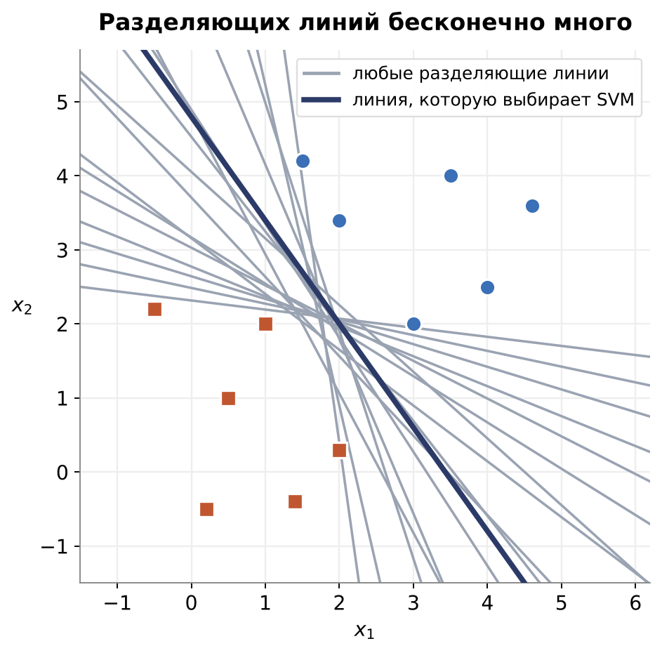

Проблема в том, что таких разделяющих линий бесконечно много. SVM выбирает ту, которая **максимально далеко отстоит
от обоих классов**, то есть проводит линию строго посередине самой широкой «улицы», которую можно провести между классами.
Эта улица называется **margin** (зазор). Чем шире зазор, тем устойчивее решение к шуму и новым данным.

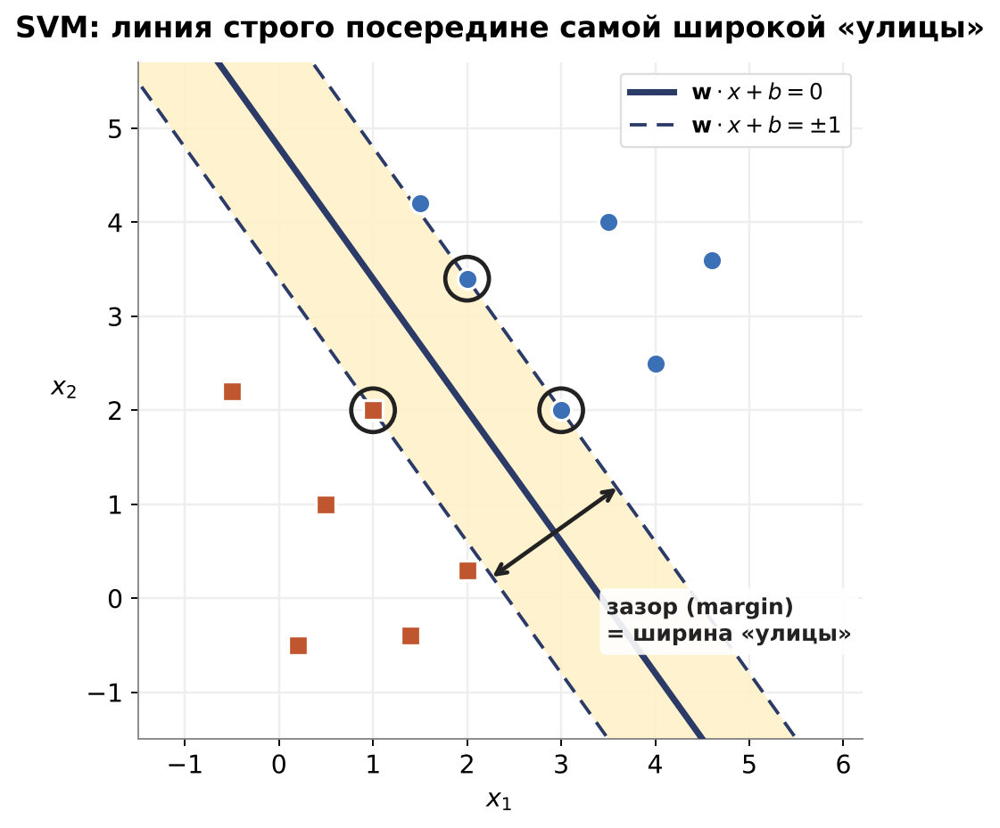

Пунктирные линии на графике — границы улицы. Что они значат и откуда берутся числа $\pm1$, разберём в шаге 4.

### 0.2. Зачем нужен зазор

Нам мало просто разделить имеющиеся данные: нужно, чтобы линия хорошо определяла классы и на **новых** данных тоже.

На графике ниже все три линии правильно делят обучающие точки. Но больше доверия внушает линия B: вокруг неё
самая широкая полоса, в которой нет ни одной точки. У узких линий A и C новая точка рядом с границей легко
окажется не по ту сторону.

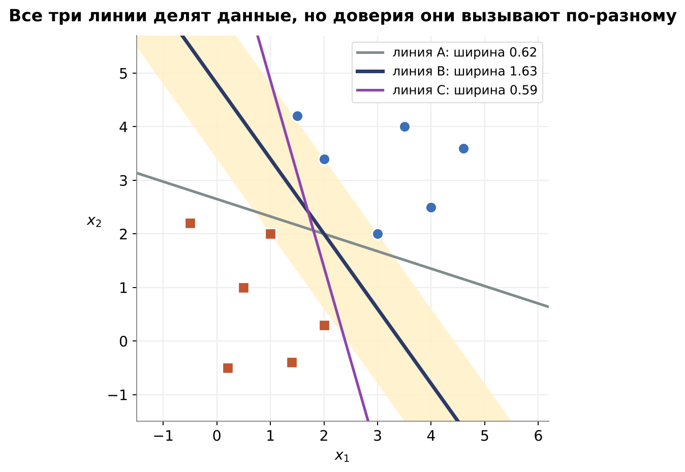

Для этого и появляется параметр **ширина**, который нужно максимизировать.

Расстояние (ширина) считается по **опорным векторам**. Опорный вектор — это один или несколько элементов выборки,
которые находятся к разделяющей прямой ближе всего. На графике «улицы» выше они обведены кружком. Подробно о них будет в шаге 4.1.

### 0.3. Уравнение гиперплоскости

Гиперплоскость задаётся так:

$$\mathbf{w}\cdot\mathbf{x} + b = 0$$

где $\mathbf{w}$ — вектор весов (нормаль к плоскости, то есть он перпендикулярен ей), $\mathbf{x}$ — точка, $b$ — смещение (bias).

Все примеры дальше считаем на одной и той же линии:

$$3x_1 + 5x_2 + 2 = 0$$

Здесь $\mathbf{w} = (3,\,5)$, $\mathbf{x} = (x_1,\,x_2)$, $b = 2$. В двух измерениях гиперплоскость — это просто линия.

**Вопрос:** почему $\mathbf{w}$ перпендикулярен плоскости? Ответ в шагах 1 и 2 ниже.

### 0.4. Как найти ширину и с какой стороны точка

Слева линия 1 с узкой полосой, справа линия 2 с широкой. Мы видим, что линия 2 имеет большую ширину, чем линия 1.

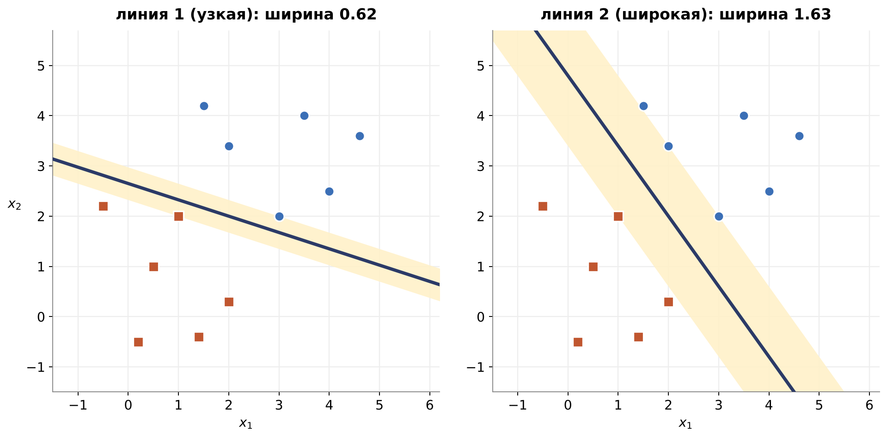

**Как можно найти ширину прямой?** Сначала нужно научиться определять, с какой стороны от линии находится точка.
Для этого берём скалярное произведение этой точки и нормали этой прямой. Соответственно, параметр, который мы будем искать, —
это параметр, который задаёт нормаль нашей разделяющей прямой, вектор $\mathbf{w}$.

Для простоты возьмём линию, проходящую через начало координат ($b = 0$), с нормалью $\mathbf{w} = (-1,\,1)$.

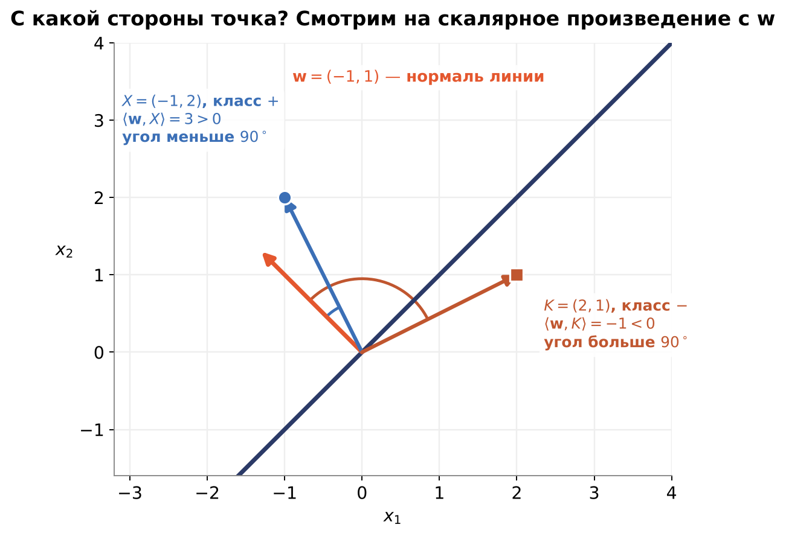

- Точка $X = (-1,\,2)$ из положительного класса: угол между ней и $\mathbf{w}$ меньше $90^\circ$,
  скалярное произведение $\langle\mathbf{w},X\rangle = 1 + 2 = 3 > 0$.
- Точка $K = (2,\,1)$ из отрицательного класса: угол больше $90^\circ$,
  скалярное произведение $\langle\mathbf{w},K\rangle = -2 + 1 = -1 < 0$.

Если записать метки классов как $y = +1$ и $y = -1$, то в обоих случаях произведение положительное:
$1\cdot 3 = 3 > 0$ и $(-1)\cdot(-1) = 1 > 0$. Поэтому «все точки лежат по свою сторону линии» записывается одним условием:

$$y_i\,\langle\mathbf{w},\,x_i\rangle > 0 \quad\text{для всех точек } i$$

Если линия не проходит через начало координат, добавляется смещение $b$:

$$y_i\,(\mathbf{w}\cdot x_i + b) > 0$$

Дальше мы усилим это условие до $\geq 1$ (шаг 4). А чтобы найти ширину, нам нужно уметь измерять расстояние
от точки до линии. Этому посвящены шаги 1–3, а саму ширину мы выведем в шаге 4.6.

---

## 1. Нормаль к линии

Строим перпендикуляр к линии $3x_1 + 5x_2 + 2 = 0$. Такой перпендикуляр называется **нормалью**.

**Как получить вектор нормали.** Смотрим на исходную формулу $3x_1 + 5x_2 + 2 = 0$
и выдёргиваем оттуда коэффициенты при $x_1$ и $x_2$. Составляем из них вектор:

$$\mathbf{w} = (3,\,5)$$

Это и есть вектор нормали. Отдельно считать ничего не нужно: он «читается» прямо из уравнения.
Свободный член $+2$ в вектор не входит, он нужен только для положения линии.

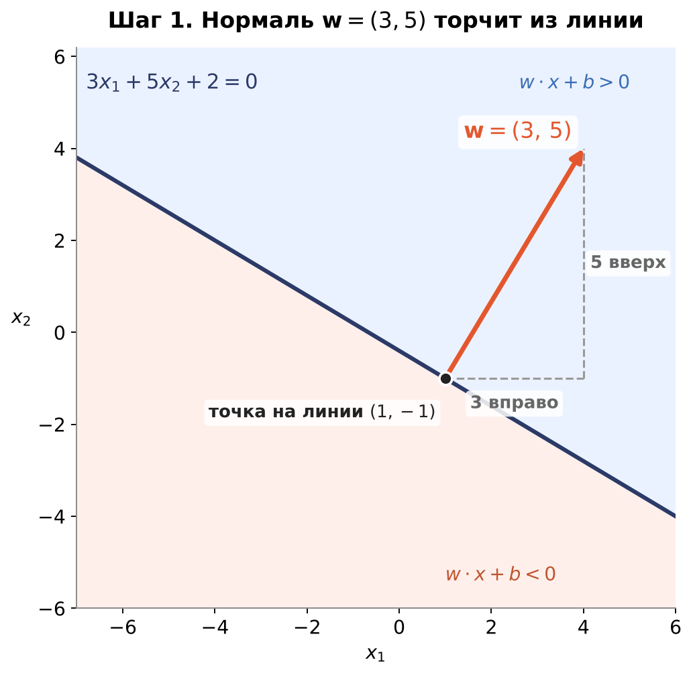

Как читать график: вектор $\mathbf{w} = (3,\,5)$ нарисован из точки $(1,\,-1)$, которая лежит на линии.
Проверка: $3\cdot 1 + 5\cdot(-1) + 2 = 3 - 5 + 2 = 0$.
От этой точки идём вправо по $x_1$ на 3 единицы и вверх по $x_2$ на 5 единиц.

**Факты о нормали:**

- Она не лежит на линии, она торчит из неё строго перпендикулярно.
- Она содержит всю необходимую информацию о наклоне линии $3x_1 + 5x_2 + 2 = 0$.
  Если поменять $\mathbf{w}$, наклон линии поменяется.

Пока это только утверждение. В следующем шаге проверим его.

---

## 2. Проверяем перпендикулярность: связь линии и вектора нормали

**Вопрос.** Как убедиться, что вектор $(3,\,5)$ действительно описывает линию
$3x_1 + 5x_2 + 2 = 0$, а не какую-то другую?

**Идея.** Если $\mathbf{w}$ перпендикулярен линии, то он должен быть перпендикулярен любому
вектору, который лежит на этой линии. Проверим это на одном таком векторе.

### 2.1. Берём две точки на линии

Важно не запутаться: обе точки берём именно **из самой линии** $3x_1 + 5x_2 + 2 = 0$.
Они нужны, чтобы построить вектор, который лежит на линии.

$$A = (1,\,-1) \qquad 3\cdot 1 + 5\cdot(-1) + 2 = 0 \;\checkmark$$

$$B = (-4,\,2) \qquad 3\cdot(-4) + 5\cdot 2 + 2 = 0 \;\checkmark$$

### 2.2. Строим вектор из двух точек

Правило: **конец минус начало**. Вектор, идущий из точки $A$ в точку $B$,
равен координатам $B$ минус координаты $A$, покоординатно:

$$\vec{AB} = B - A = \bigl(-4 - 1,\; 2 - (-1)\bigr) = (-5,\,3)$$

Это стрелка, которая лежит прямо на нашей линии.

Обратный вариант тоже верен. Вектор из $B$ в $A$:

$$\vec{BA} = A - B = \bigl(1 - (-4),\; -1 - 2\bigr) = (5,\,-3)$$

$\vec{BA}$ — тот же вектор с обратным знаком ($\vec{BA} = -\vec{AB}$). Они оба лежат на одной линии,
просто смотрят в разные стороны, поэтому подходит любой из них.

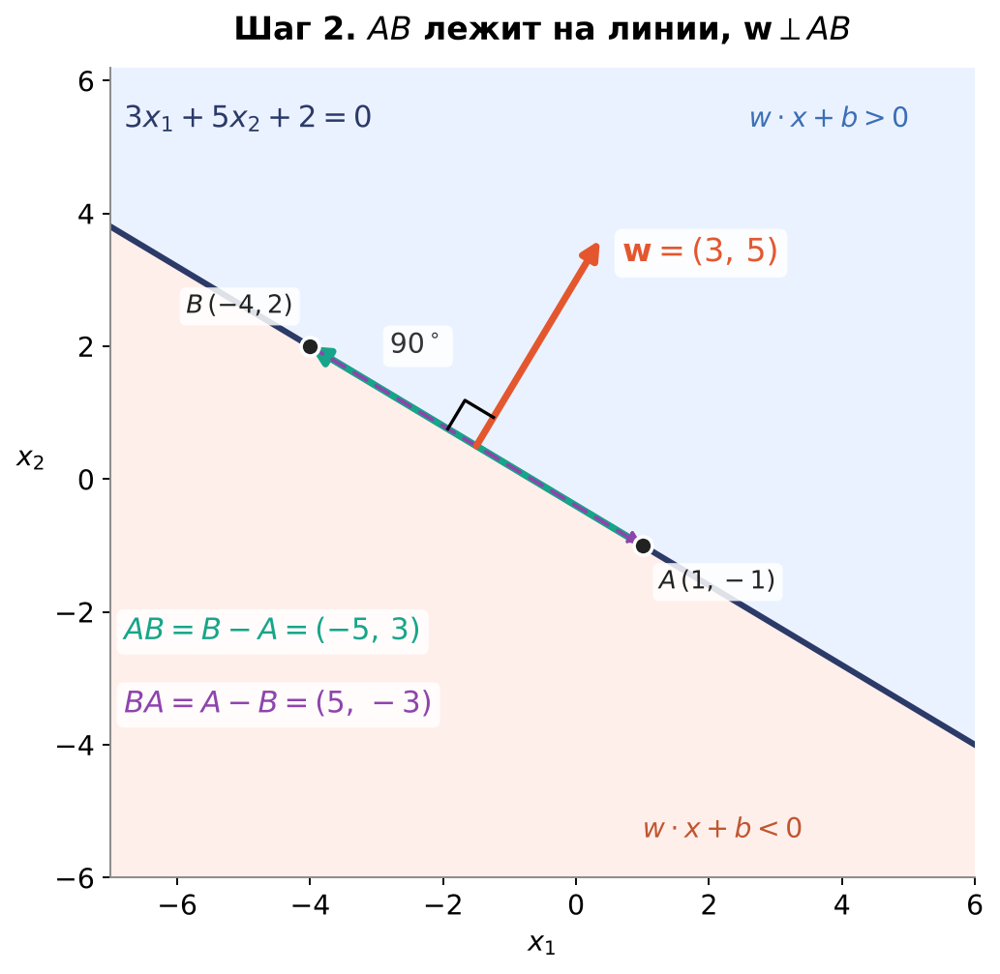

### 2.3. Скалярное произведение (кратко)

Скалярное произведение двух векторов показывает, насколько они сонаправлены:

$$\mathbf{a}\cdot\mathbf{b} = a_1 b_1 + a_2 b_2 = |\mathbf{a}|\,|\mathbf{b}|\cos\theta$$

- больше нуля — векторы смотрят примерно в одну сторону;
- меньше нуля — примерно в противоположные;
- ноль — угол между ними $90^\circ$, то есть они перпендикулярны.

### 2.4. Проверяем угол между $\mathbf{w}$ и $\vec{AB}$

$$\mathbf{w}\cdot\vec{AB} = 3\cdot(-5) + 5\cdot 3 = -15 + 15 = 0$$

Ноль означает, что угол между ними равен $90^\circ$, то есть они **перпендикулярны**.

**Вывод.** $\mathbf{w} = (3,\,5)$ действительно перпендикулярен линии $3x_1 + 5x_2 + 2 = 0$.
Для обратного вектора $\vec{BA}$ результат тот же: $3\cdot 5 + 5\cdot(-3) = 0$.

---

## 3. Расстояние от точки до гиперплоскости

Теперь самое важное для SVM: как посчитать расстояние от точки до линии.

### 3.1. Какие точки берём

Не путаем две точки:

- $x_p = (1,\,-1)$ — точка **на линии** (мы её уже использовали, это $A$);
- $x_0 = (-3,\,-2)$ — точка **вне линии**, расстояние до которой хотим найти.

Проверим, что $x_0$ не лежит на линии: $3\cdot(-3) + 5\cdot(-2) + 2 = -9 - 10 + 2 = -17$.
Не ноль, значит точка вне линии.

От точки на линии строим вектор до точки $x_0$. Правило то же: «конец минус начало».

$$\mathbf{v} = x_0 - x_p = \bigl(-3 - 1,\; -2 - (-1)\bigr) = (-4,\,-1)$$

Вектор $\mathbf{v}$ выходит из точки $x_p$.

### 3.2. Раскладываем $\mathbf{v}$ на две составляющие

Вектор $\mathbf{v}$ можно разложить на:

- составляющую **вдоль линии** (зелёная стрелка на графике);
- составляющую **вдоль нормали** $\mathbf{w}$ (красная стрелка).

Длина красной составляющей — это и есть искомое расстояние $d$: она идёт от основания
перпендикуляра на линии прямо до $x_0$.

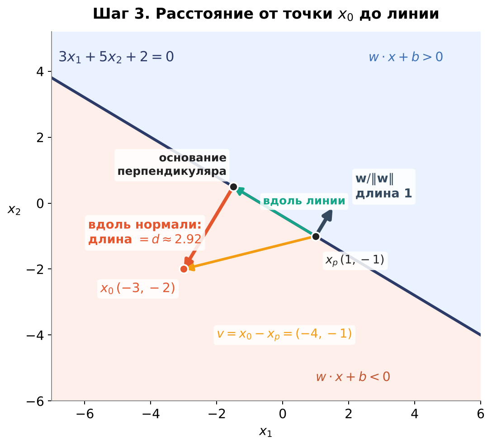

### 3.3. Что такое $\mathbf{w}/\|\mathbf{w}\|$

Нормаль $\mathbf{w} = (3,\,5)$ показывает направление, но у неё своя длина. Для измерения расстояния
нужна стрелка длины ровно 1 в том же направлении. Получаем её делением на длину:

$$\|\mathbf{w}\| = \sqrt{3^2 + 5^2} = \sqrt{34} \approx 5.83$$

$$\frac{\mathbf{w}}{\|\mathbf{w}\|} = \frac{(3,\,5)}{5.83} \approx (0.51,\;0.86)$$

Это **единичный вектор нормали**. На графике он показан тёмной короткой стрелкой из $x_p$:
то же направление, что у $\mathbf{w}$, но длина 1. Его удобно использовать как линейку.

### 3.4. Расстояние — это проекция $\mathbf{v}$ на $\mathbf{w}/\|\mathbf{w}\|$

Проекция вектора на единичный вектор — это просто скалярное произведение с ним:

$$\text{проекция} = \mathbf{v}\cdot\frac{\mathbf{w}}{\|\mathbf{w}\|} = \frac{\mathbf{v}\cdot\mathbf{w}}{\|\mathbf{w}\|}$$

Считаем по шагам:

$$\mathbf{v}\cdot\mathbf{w} = (-4)\cdot 3 + (-1)\cdot 5 = -12 - 5 = -17$$

$$\text{проекция} = \frac{-17}{\sqrt{34}} \approx \frac{-17}{5.83} \approx -2.92$$

Знак минус говорит о том, что $x_0$ лежит с **обратной** от $\mathbf{w}$ стороны: нормаль $\mathbf{w}$ смотрит
вверх-вправо, а $x_0$ находится вниз-влево от линии. Само расстояние всегда положительное,
поэтому берём модуль:

$$d = \frac{|-17|}{\sqrt{34}} \approx 2.92$$

Проверка по графику: красная стрелка идёт из $(-1.5,\,0.5)$ в $(-3,\,-2)$,
её длина $\sqrt{1.5^2 + 2.5^2} = \sqrt{8.5} \approx 2.92$. ✓

### 3.5. Избавляемся от выбора точки $x_p$

Согласитесь, неудобно каждый раз искать конкретную точку на линии и от неё считать проекцию.
Давайте уберём этот шаг, чтобы считать расстояние сразу по самой точке $x_0$.

До сих пор мы просто делали обычную вещь: взяли один вектор, спроектировали на другой и
получили расстояние. Теперь упростим формулу.

Расписываем $\mathbf{v} = x_0 - x_p$:

$$d = \frac{|\mathbf{w}\cdot\mathbf{v}|}{\|\mathbf{w}\|}
= \frac{|\mathbf{w}\cdot(x_0 - x_p)|}{\|\mathbf{w}\|}
= \frac{|\mathbf{w}\cdot x_0 - \mathbf{w}\cdot x_p|}{\|\mathbf{w}\|}$$

Точка $x_p$ лежит **на линии**, значит удовлетворяет её уравнению:

$$\mathbf{w}\cdot x_p + b = 0 \quad\Longrightarrow\quad \mathbf{w}\cdot x_p = -b$$

Проверка на числах: $\mathbf{w}\cdot x_p = 3\cdot 1 + 5\cdot(-1) = -2$, и действительно $-b = -2$.

Подставляем $-b$ вместо $\mathbf{w}\cdot x_p$:

$$d = \frac{|\mathbf{w}\cdot x_0 - (-b)|}{\|\mathbf{w}\|}$$

Минус на минус даёт плюс. Итоговая формула:

$$\boxed{\,d = \frac{|\mathbf{w}\cdot x_0 + b|}{\|\mathbf{w}\|}\,}$$

Проверяем на нашем примере:

$$\mathbf{w}\cdot x_0 + b = 3\cdot(-3) + 5\cdot(-2) + 2 = -17
\qquad\Rightarrow\qquad
d = \frac{|-17|}{\sqrt{34}} \approx 2.92$$

Получилось то же самое число, что и через $x_p$.

### 3.6. Что нам это дало

Мы избавились от необходимости знать точку на плоскости. Теперь для расстояния нужны
только:

- параметры самой гиперплоскости $\mathbf{w}$ и $b$;
- координаты точки $x_0$ вне плоскости.

Заодно получили бонус: знак выражения $\mathbf{w}\cdot x_0 + b$ говорит, по какую сторону
от плоскости лежит точка (на графиках это синяя и розовая области). Здесь он отрицательный
($-17$), то есть точка с обратной от $\mathbf{w}$ стороны. Именно на этом держится
классификация в SVM.

---

## 4. Опорные векторы и «канонический» вид

Из шага 3 нам нужна только одна формула, запомните её:

$$d = \frac{|\mathbf{w}\cdot x_0 + b|}{\|\mathbf{w}\|}$$

Дальше она понадобится, чтобы посчитать ширину зазора.

### 4.1. Опорные векторы

Среди всех точек обучающей выборки есть те, что находятся **ближе всего** к разделяющей линии.
Их называют **опорными векторами** (support vectors). Именно они определяют границу зазора:
если сдвинуть любую другую точку, не заходя в зазор, линия не изменится, а если сдвинуть опорную, изменится.

На графиках ниже опорные векторы обведены кружком: по одному ближайшему на каждый класс.
Синие круги — класс $+1$, красные квадраты — класс $-1$.

### 4.2. У одной линии бесконечно много записей

Уравнение $\mathbf{w}\cdot\mathbf{x} + b = 0$ можно масштабировать: умножить и $\mathbf{w}$, и $b$ на любое число $k \neq 0$.
Линия геометрически не изменится. Пример с $k = 2$:

$$3x_1 + 5x_2 + 2 = 0 \quad\xrightarrow{\;\cdot\,2\;}\quad 6x_1 + 10x_2 + 4 = 0$$

Это одна и та же линия. Меняется только длина вектора нормали: $\mathbf{w} = (3,\,5)$ превращается в $(6,\,10)$,
а направление остаётся прежним.

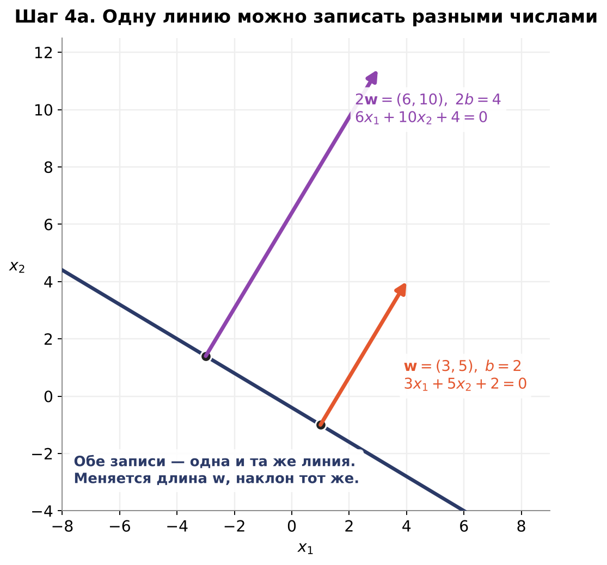

Значит, у одной линии бесконечное количество вариантов записи. А раз мы можем выбрать любой,
**выбираем самый удобный**.

### 4.3. Какой масштаб удобнее всего

Хотим, чтобы по результату $\mathbf{w}\cdot x + b$ можно было сразу читать ответ:

- результат $\geq +1$ — точка положительного класса;
- результат $\leq -1$ — точка отрицательного класса.

Для этого договоримся зафиксировать масштаб так, чтобы для **ближайших** точек (опорных векторов) выполнялось ровно:

$$\mathbf{w}\cdot x + b = +1 \quad\text{для ближайших точек класса } +1$$

$$\mathbf{w}\cdot x + b = -1 \quad\text{для ближайших точек класса } -1$$

Это две параллельные линии по обе стороны от разделяющей. Между ними лежит «нейтральная полоса»,
в которой обучающих точек нет вообще.

### 4.4. Как подогнать $\mathbf{w}$ и $b$: пример

Возьмём наши данные. Ближайшие к линии $3x_1 + 5x_2 + 2 = 0$ точки:

$$\text{класс } +1:\ (4,\,-2) \;\Rightarrow\; 3\cdot4 + 5\cdot(-2) + 2 = 4$$

$$\text{класс } -1:\ (-2,\,0) \;\Rightarrow\; 3\cdot(-2) + 5\cdot0 + 2 = -4$$

Получилось $+4$ и $-4$, а нужно $+1$ и $-1$.

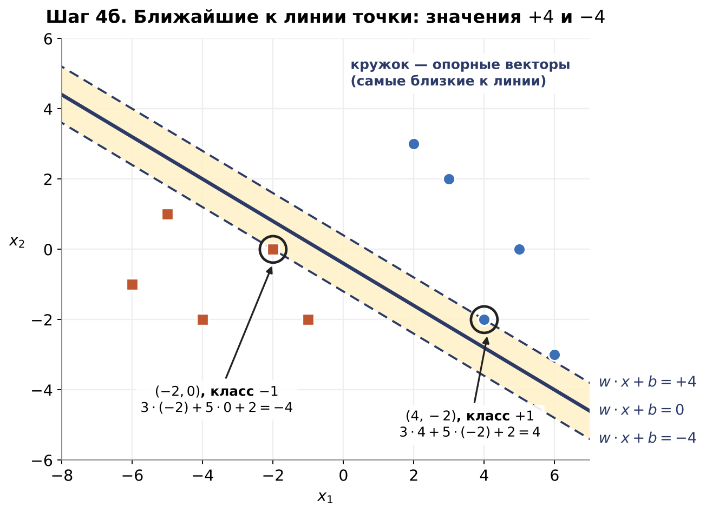

**Вопрос:** что сделать с $\mathbf{w}$ и $b$, чтобы вместо $4$ и $-4$ получить $1$ и $-1$?

**Ответ:** умножить их на $\tfrac{1}{4}$. Тогда все значения $\mathbf{w}\cdot x + b$ уменьшатся ровно в 4 раза.

$$\mathbf{w} = \tfrac14\cdot(3,\,5) = (0.75,\;1.25)$$

$$b = \tfrac14\cdot 2 = 0.5$$

Проверяем:

$$0.75\cdot4 + 1.25\cdot(-2) + 0.5 = 3 - 2.5 + 0.5 = 1 \;\checkmark$$

$$0.75\cdot(-2) + 1.25\cdot0 + 0.5 = -1.5 + 0.5 = -1 \;\checkmark$$

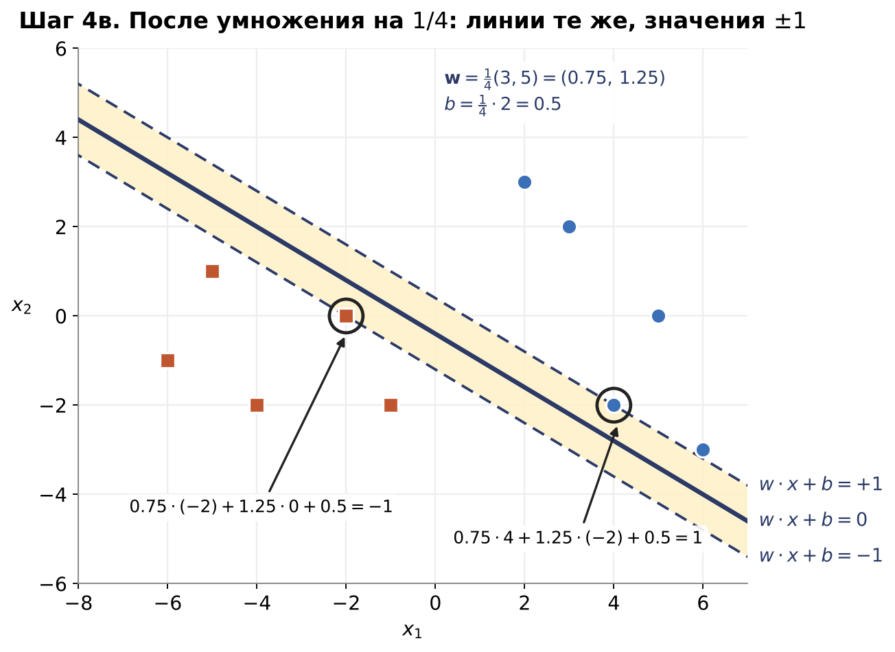

Обратите внимание: линии на графике остались на тех же местах. Мы поменяли только числа в записи.
В общем случае множитель равен единице, делённой на значение у ближайшей точки (в примере $k = 1/4$).

### 4.5. Одно условие вместо двух

Требования к классам можно записать одной формулой. Пусть $y_i = +1$ для класса $+1$ и $y_i = -1$ для класса $-1$.

$$y_i\,(\mathbf{w}\cdot x_i + b) \geq 1$$

Почему это работает:

- при $y_i = +1$ получаем $\mathbf{w}\cdot x_i + b \geq 1$;
- при $y_i = -1$ умножение на $-1$ меняет знак неравенства: $-(\mathbf{w}\cdot x_i + b) \geq 1$, то есть $\mathbf{w}\cdot x_i + b \leq -1$.

То есть условие «результат $\geq 1$ или $\leq -1$» уже заложено в формулу с самого начала как ограничение.

На графике у каждой точки подписано значение $y\cdot(\mathbf{w}\cdot x + b)$: у опорных векторов ровно $1$, у остальных больше.

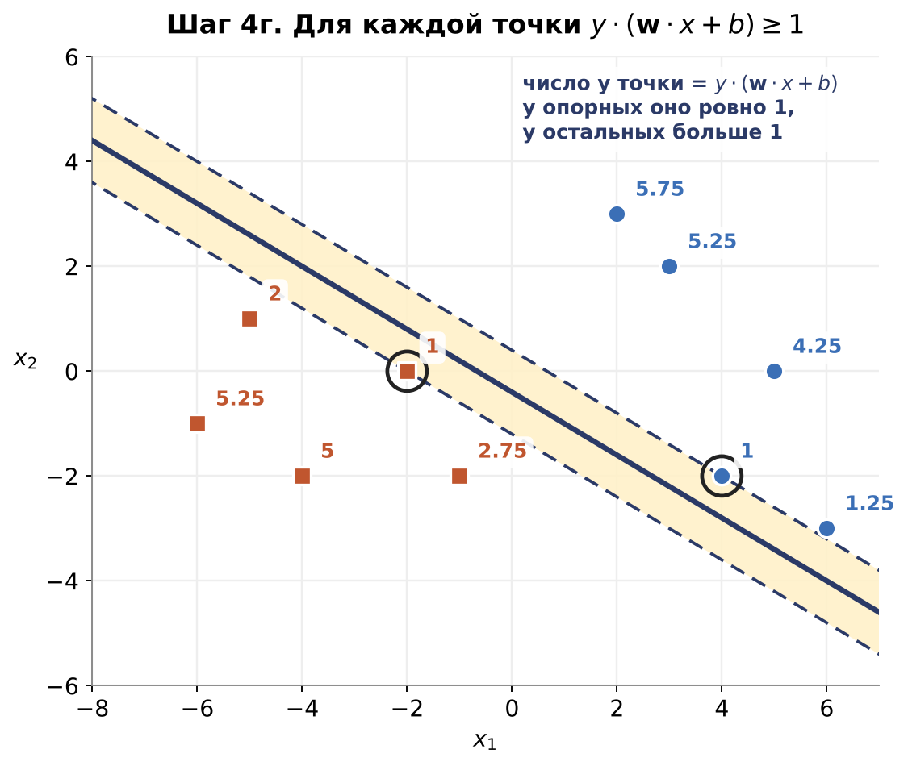

### 4.6. Ширина зазора (margin)

Теперь выясним, чему равна ширина зазора. Именно её SVM старается сделать как можно больше.

**Шаг 1. Две граничные гиперплоскости.** Назовём их $H_+$ и $H_-$:

$$H_+:\ \mathbf{w}\cdot x + b = +1 \qquad\qquad H_-:\ \mathbf{w}\cdot x + b = -1$$

Возьмём любую точку $x^+$ на плоскости $H_+$ и любую точку $x^-$ на плоскости $H_-$.
Это просто точки на плоскостях, не обязательно из обучающей выборки. Для них выполняется:

$$\mathbf{w}\cdot x^+ + b = 1 \qquad\qquad \mathbf{w}\cdot x^- + b = -1$$

**Шаг 2. Какое расстояние считаем.** Расстояние между двумя параллельными плоскостями — это **кратчайший** путь
от одной до другой. Из точки $x^-$ до плоскости $H_+$ можно дойти по-разному (график ниже):

- наискосок, и тогда вектор $x^+ - x^-$ **не параллелен** $\mathbf{w}$: путь получается длиннее, как гипотенуза длиннее катета;
- строго поперёк, вдоль нормали, и тогда вектор $x^+ - x^-$ **параллелен** $\mathbf{w}$: это самый короткий путь.

Нам нужен второй вариант. На графике из точки $x^- = (-2,\,0)$ наискосок до $(4,\,-2)$ получается $\sqrt{40} \approx 6.32$,
а вдоль нормали всего около $1.37$.

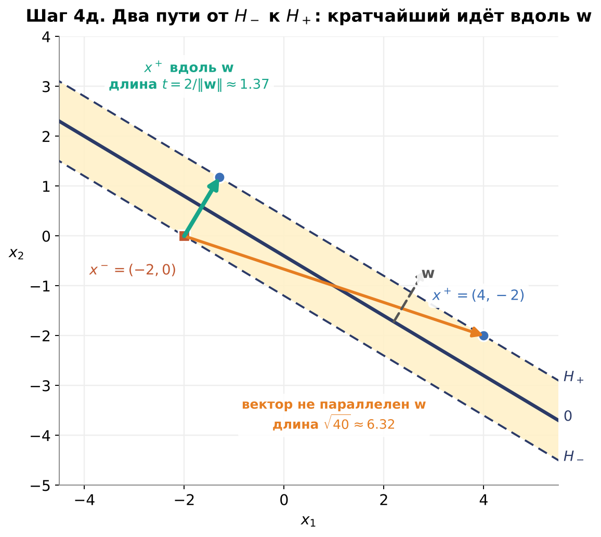

**Шаг 3. Вычитаем уравнения.** Из первого равенства вычитаем второе:

$$(\mathbf{w}\cdot x^+ + b) - (\mathbf{w}\cdot x^- + b) = 1 - (-1) = 2$$

Слагаемое $b$ сокращается, а $\mathbf{w}\cdot x^+ - \mathbf{w}\cdot x^-$ собирается в одно скалярное произведение:

$$\mathbf{w}\cdot(x^+ - x^-) = 2$$

**Шаг 4. Записываем вектор $x^+ - x^-$ через его длину.** Поскольку $x^+ - x^-$ параллелен $\mathbf{w}$ (вектору нормали),
его можно представить так:

$$x^+ - x^- = t\cdot\frac{\mathbf{w}}{\|\mathbf{w}\|}$$

Здесь:

- $\dfrac{\mathbf{w}}{\|\mathbf{w}\|}$ — единичный вектор в направлении нормали, его длина равна 1 (мы уже строили его в шаге 3.3);
- $t$ — число (скаляр), длина вектора $x^+ - x^-$. Это и есть расстояние между плоскостями, которое мы ищем.

**Шаг 5. Подставляем.** Берём $\mathbf{w}\cdot(x^+ - x^-) = 2$ и вместо $x^+ - x^-$ ставим $t\cdot\dfrac{\mathbf{w}}{\|\mathbf{w}\|}$:

$$\mathbf{w}\cdot\left(t\cdot\frac{\mathbf{w}}{\|\mathbf{w}\|}\right) = 2$$

Число $t$ можно вынести за скобки:

$$t\cdot\left(\frac{\mathbf{w}\cdot\mathbf{w}}{\|\mathbf{w}\|}\right) = 2$$

Дальше нужно упростить $\mathbf{w}\cdot\mathbf{w}$:

$$\frac{\mathbf{w}\cdot\mathbf{w}}{\|\mathbf{w}\|} = \frac{\|\mathbf{w}\|^2}{\|\mathbf{w}\|} = \|\mathbf{w}\|$$

**Почему $\mathbf{w}\cdot\mathbf{w} = \|\mathbf{w}\|^2$?** Это следует из двух определений.
Длина вектора считается по теореме Пифагора:

$$\|\mathbf{w}\| = \sqrt{w_1^2 + w_2^2 + \dots + w_n^2} \qquad\Longrightarrow\qquad \|\mathbf{w}\|^2 = w_1^2 + w_2^2 + \dots + w_n^2$$

А скалярное произведение вектора на самого себя перемножает одинаковые координаты:

$$\mathbf{w}\cdot\mathbf{w} = w_1\cdot w_1 + w_2\cdot w_2 + \dots + w_n\cdot w_n = w_1^2 + w_2^2 + \dots + w_n^2$$

Справа получилось то же выражение. На числах для $\mathbf{w} = (3,\,5)$: $\mathbf{w}\cdot\mathbf{w} = 9 + 25 = 34$ и $\|\mathbf{w}\|^2 = (\sqrt{34})^2 = 34$.

**Шаг 6. Ответ.** После упрощения остаётся:

$$t\cdot\|\mathbf{w}\| = 2 \qquad\Longrightarrow\qquad \boxed{\,t = \frac{2}{\|\mathbf{w}\|}\,}$$

Это и есть ширина зазора (margin).

#### Пример на числах

Проверим ту же логику на точках $x^+ = (4,\,4)$ и $x^- = (-2,\,-6)$ в исходном масштабе, где $\mathbf{w} = (3,\,5)$ и $b = 2$.

$$\mathbf{w}\cdot x^+ + b = 3\cdot4 + 5\cdot4 + 2 = 34 \qquad\qquad \mathbf{w}\cdot x^- + b = 3\cdot(-2) + 5\cdot(-6) + 2 = -34$$

Здесь значения равны $+34$ и $-34$, а не $\pm1$, потому что масштаб ещё не нормирован. Рассуждение то же, но справа в шаге 3 стоит разность значений:

$$\mathbf{w}\cdot(x^+ - x^-) = 34 - (-34) = 68 \qquad\Longrightarrow\qquad t = \frac{68}{\|\mathbf{w}\|} = \frac{68}{\sqrt{34}} \approx 11.66$$

Измерим то же расстояние напрямую, как длину вектора между точками:

$$x^+ - x^- = (6,\,10) \qquad\Longrightarrow\qquad \sqrt{(4-(-2))^2 + (4-(-6))^2} = \sqrt{136} \approx 11.66$$

Числа совпали, потому что вектор $(6,\,10)$ равен $2\mathbf{w}$, то есть параллелен нормали.

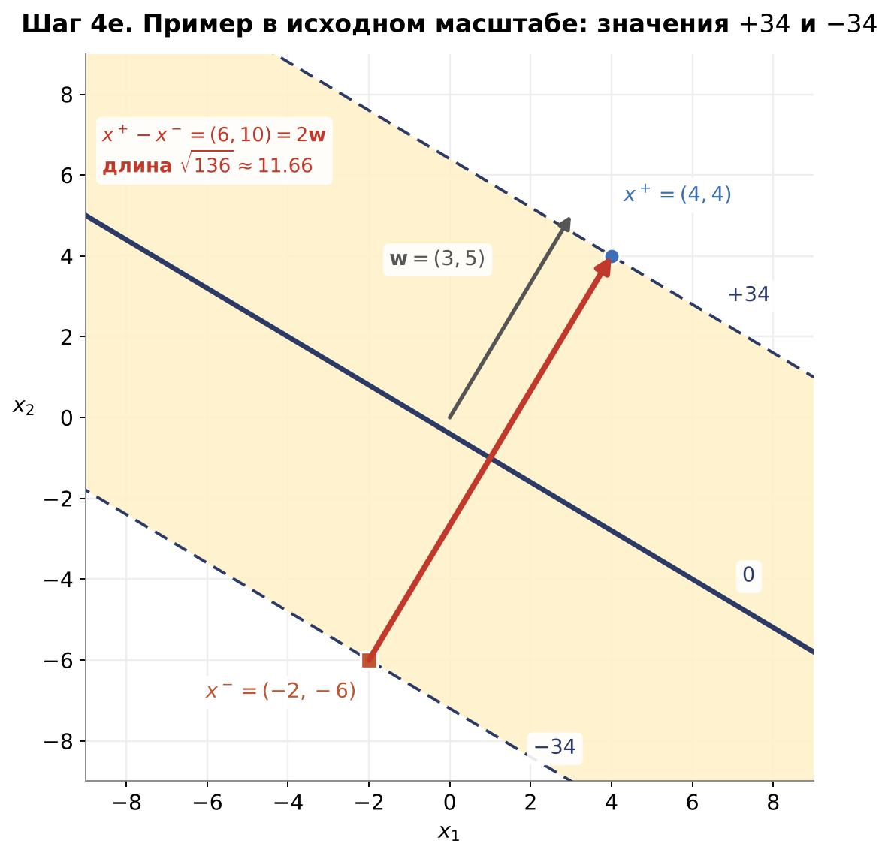

В «каноническом» масштабе значения равны ровно $+1$ и $-1$, поэтому вместо $68$ справа всегда стоит $2$.
Отсюда и получается $t = 2/\|\mathbf{w}\|$. Для нашего $\mathbf{w} = (0.75,\,1.25)$:

$$\|\mathbf{w}\| = \sqrt{0.75^2 + 1.25^2} = \sqrt{2.125} \approx 1.46 \qquad\Longrightarrow\qquad t = \frac{2}{1.46} \approx 1.37$$

#### Проверка вторым способом

Тот же результат даёт формула расстояния из шага 3. Точка на плоскости $H_+$ ($\mathbf{w}\cdot x + b = 1$)
отстоит от разделяющей линии на

$$d = \frac{|1|}{\|\mathbf{w}\|} = \frac{1}{1.46} \approx 0.69$$

Столько же до плоскости $H_-$, значит вся ширина равна $2\cdot 0.69 \approx 1.37$. Совпало.

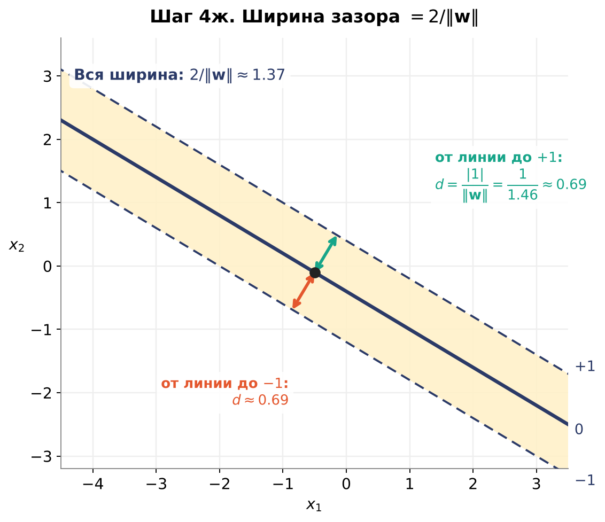

Чем меньше $\|\mathbf{w}\|$, тем шире зазор. Это главная идея SVM.

### 4.7. Итоговая постановка задачи

Мы ищем $\mathbf{w}$ и $b$ такие, что:

1. линия разделяет классы правильно;
2. для всех точек выполняется $y_i\,(\mathbf{w}\cdot x_i + b) \geq 1$ — это ограничение;
3. $\|\mathbf{w}\|$ как можно меньше — тогда ширина зазора $2/\|\mathbf{w}\|$ максимальна.

Итоговая цель:

$$\min_{\mathbf{w},\,b}\ \tfrac12\,\|\mathbf{w}\|^2 \qquad\text{при условии}\qquad y_i\,(\mathbf{w}\cdot x_i + b) \geq 1 \ \text{ для всех точек } i$$

Здесь $y_i$ — метка класса (истинная), то есть $+1$ или $-1$.

**Почему именно $\tfrac12\|\mathbf{w}\|^2$, а не просто $\|\mathbf{w}\|$.**

- Ширина зазора равна $2/\|\mathbf{w}\|$, поэтому, чтобы её максимизировать, нужно минимизировать $\|\mathbf{w}\|$.
- Берём квадрат $\|\mathbf{w}\|^2$, потому что не хотим возиться с корнем. Нам не важно само значение $\|\mathbf{w}\|$,
  важно только сравнение и выбор лучшего. У $\|\mathbf{w}\|$ и $\|\mathbf{w}\|^2$ минимум достигается при одном и том же $\mathbf{w}$,
  так как оба растут вместе.
- Множитель $\tfrac12$ добавляем, чтобы потом при взятии производной он сократился с двойкой:
  $\dfrac{d}{d\mathbf{w}}\left(\tfrac12\|\mathbf{w}\|^2\right) = \mathbf{w}$.
