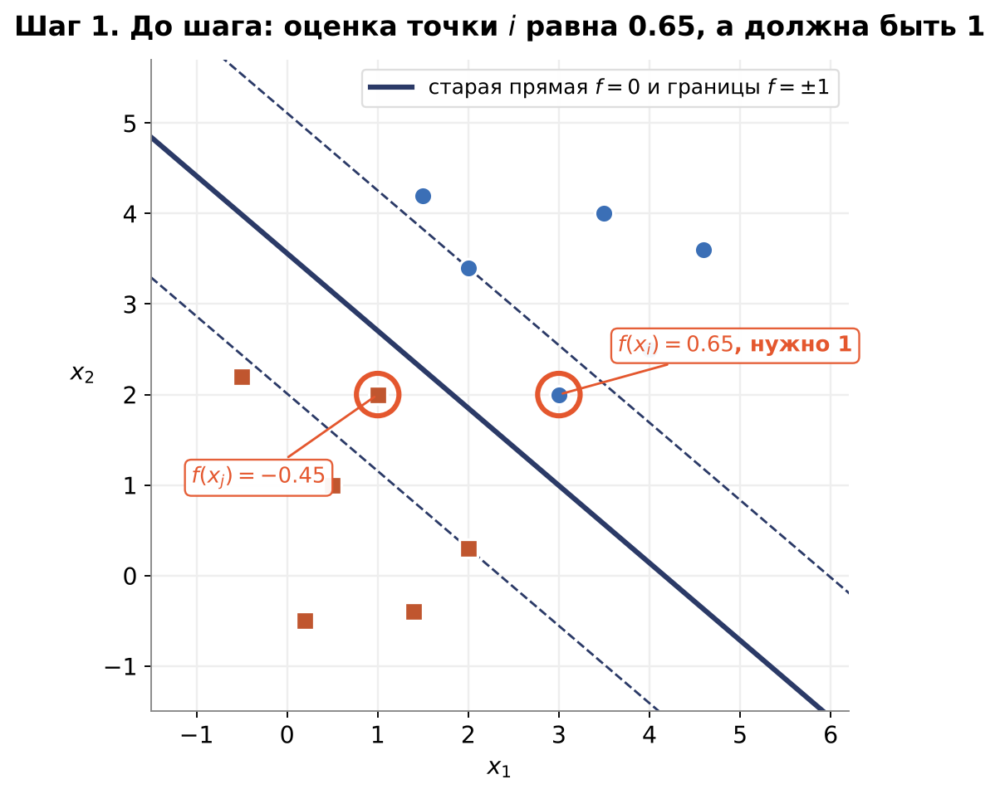
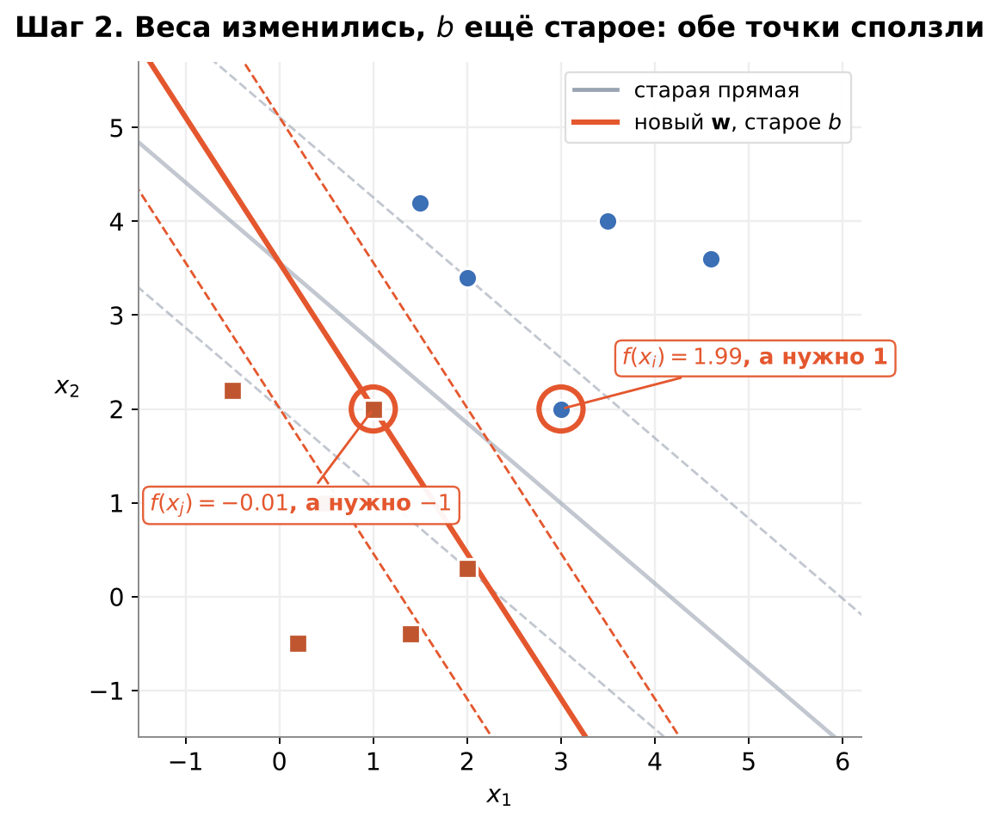
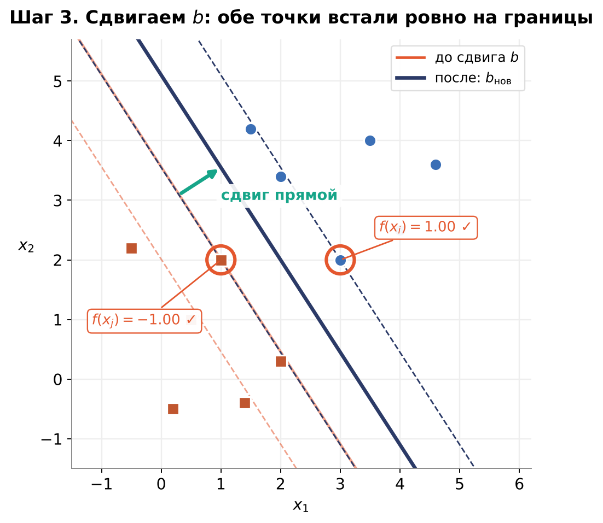
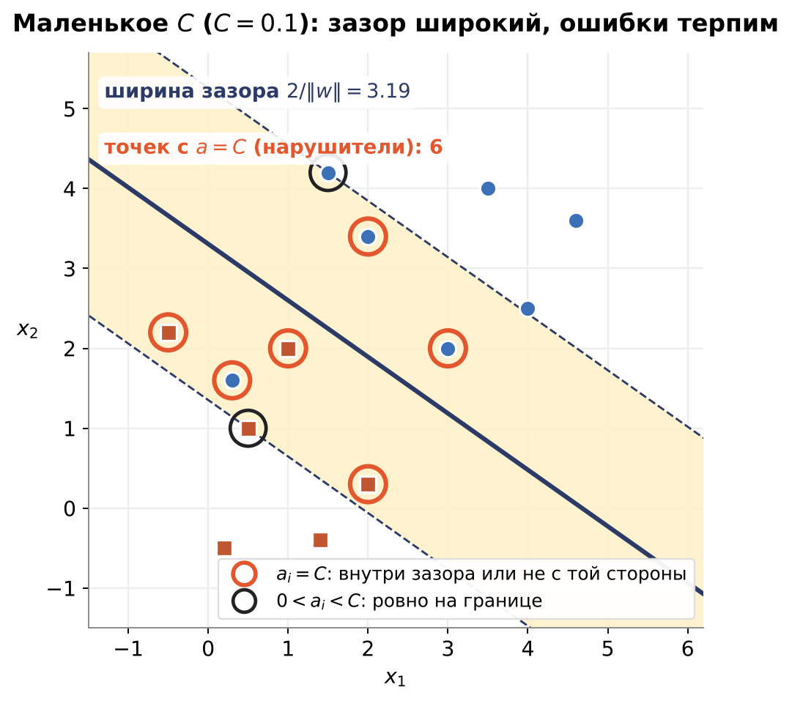
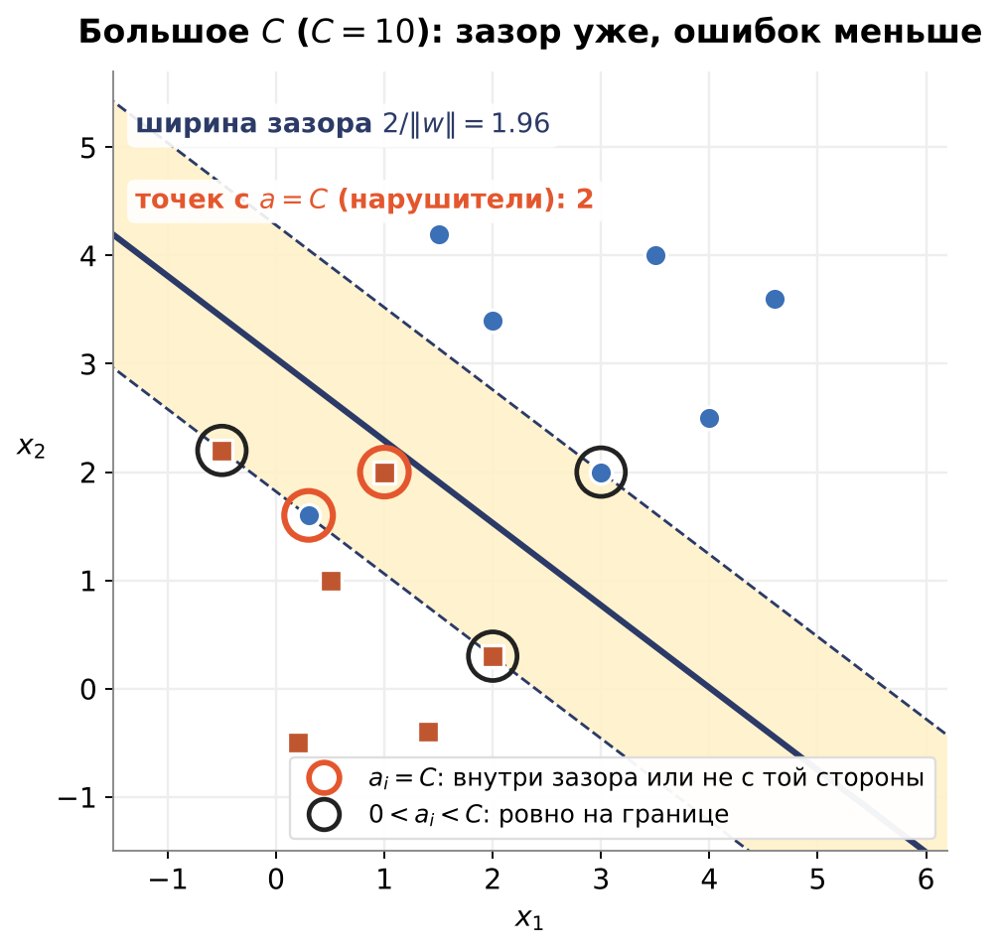

# SVM. Часть 3. Решение задачи: dual (двойственная постановка)

## 0. Итоговая цель и зачем нужен Лагранж

Из части 1 мы пришли к такой задаче:

$$\min_{\mathbf{w},\,b}\ \tfrac12\,\|\mathbf{w}\|^2 \qquad\text{при условии}\qquad y_i\,(\mathbf{w}\cdot x_i + b) \geq 1 \ \text{ для всех точек } i$$

Здесь $y_i$ — истинная метка класса ($+1$ или $-1$).

Это задача **условной оптимизации**: функцию нужно минимизировать, но при ограничениях-неравенствах.
Просто взять производную и приравнять к нулю нельзя: ограничения мешают, минимум может лежать на границе допустимой области.

**Метод Лагранжа** — это способ встроить ограничения прямо в функцию. К ней добавляются слагаемые с ограничениями,
умноженные на специальные числа (множители):

$$L(\mathbf{w},\,b,\,a) = \tfrac12\|\mathbf{w}\|^2 - \sum_i a_i\bigl(y_i(\mathbf{w}\cdot x_i + b) - 1\bigr)$$

### 0.1. Что такое Лагранжиан

**Лагранжиан** — это новая функция, в которую в одно выражение собраны и то, что мы минимизируем, и ограничения.
Для задачи «минимизировать $f(x)$ при ограничении $g(x) \geq 0$» он строится так:

$$L(x,\,a) = f(x) - a\,g(x), \qquad a \geq 0$$

- $f(x)$ — исходная функция, которую минимизируем (у нас это $\tfrac12\|\mathbf{w}\|^2$);
- $g(x) \geq 0$ — ограничение, записанное в таком виде (у нас $y_i(\mathbf{w}\cdot x_i + b) - 1 \geq 0$);
- $a$ — **множитель Лагранжа**, по одному на каждое ограничение. Его можно понимать как «цену» нарушения ограничения.

Главная идея: для допустимых $x$ добавка $a\,g(x)$ неотрицательна и ничего не портит, а для недопустимых мы можем сделать её сколь угодно большой,
выбрав большое $a$. Подробно это увидим на примере в разделе 1.

### 0.2. План решения

Решать будем в такой последовательности. Каждый пункт потом разберём на числах.

1. Записать ограничения в виде $g(x) \geq 0$.
2. Построить лагранжиан: $L(x,\,a) = f(x) - a\,g(x)$, $\;a \geq 0$.
3. Записать исходную (**примальную**) задачу через лагранжиан: $\;p^* = \min_x \max_{a \geq 0} L(x,\,a)$.
4. Поменять $\min$ и $\max$ местами (**двойственная** задача): $\;d^* = \max_{a \geq 0} \min_x L(x,\,a)$.
   Для выпуклых задач ответ не меняется: $p^* = d^*$.
5. Решить внутреннюю задачу: взять производную $\dfrac{\partial L}{\partial x} = 0$ и выразить $x$ через $a$.
6. Подставить найденное $x$ обратно в $L$. Получится **двойственная функция** $D(a)$, которая зависит только от $a$.
7. Максимизировать $D(a)$ по $a \geq 0$ и найти $a^*$.
8. Восстановить ответ $x^*$ из $a^*$.

Сначала пройдём все восемь шагов на простом примере, а потом повторим то же для SVM.

---

## 1. Простой пример: $\min x^2$ при $x \geq 1$

Ответ здесь очевиден: $x = 1$, минимум равен $1$. Но решим задачу через Лагранжиан, чтобы увидеть весь метод.

### 1.1. Строим Лагранжиан

Запишем ограничение в форме $g(x) \geq 0$. У нас $g(x) = x - 1 \geq 0$.

$$L(x,\,a) = x^2 - a\,(x - 1), \qquad a \geq 0$$

- $x^2$ — то, что минимизируем;
- $a\,(x-1)$ — ограничение $g(x)$, умноженное на множитель $a$.

### 1.2. Почему именно минус

- Если $x$ допустимо (то есть $x \geq 1$, значит $g(x) = x - 1 \geq 0$), то слагаемое $a(x-1)$ — неотрицательное число
  (раз $a \geq 0$ и $g(x) \geq 0$).
- Значит, вычитание этого слагаемого **уменьшает** $L$ относительно исходной функции: $L(x, a) \leq x^2$.

Проверим на числах при $a = 1$:

| $x$ | допустимо? | $L(x, 1) = x^2 - (x-1)$ | сравнение с $x^2$ |
|---|---|---|---|
| $3$ | да | $9 - 2 = 7$ | $7 \leq 9$ |
| $2$ | да | $4 - 1 = 3$ | $3 \leq 4$ |
| $1$ | да (граница) | $1 - 0 = 1$ | $1 \leq 1$ |
| $-1$ | **нет** | $1 - (-2) = 3$ | $3 > 1$ |

Для допустимых точек $L \leq x^2$. Для недопустимой точки наоборот $L$ становится **больше**, и дальше мы увидим, что это важно.

### 1.3. Что будет, если взять максимум по $a$

Для фиксированного $x$ возьмём максимум $L$ по $a \geq 0$:

$$\max_{a \geq 0}\ \bigl[x^2 - a(x-1)\bigr]$$

- Если $x - 1 > 0$ (строго, с запасом): при росте $a$ слагаемое $-a(x-1)$ только уменьшается. Выгоднее всего взять $a = 0$, и максимум равен просто $x^2$.
- Если $x - 1 = 0$ (граница): слагаемое всегда $0$ независимо от $a$, максимум опять $x^2$.
- Если $x$ недопустимо ($x < 1$, значит $x - 1 < 0$): тогда $-a(x-1) = a\,(1 - x) > 0$, и это растёт без ограничений при $a \to \infty$.
  Максимум равен $+\infty$.

Получаем красивый факт:

$$\max_{a \geq 0} L(x,\,a) = \begin{cases} x^2, & x \geq 1 \ \text{(допустимо)} \\ +\infty, & x < 1 \ \text{(недопустимо)} \end{cases}$$

То есть операция $\max L$ сама **запрещает недопустимые точки**: для них она выдаёт бесконечность.

**Как именно получается $+\infty$.** Здесь мы **максимизируем по $a$**: подбираем $a \geq 0$ так, чтобы $L$ было как можно больше.
Посмотрим на две точки.

Недопустимая точка $x = 0$: $\;L(0,\,a) = 0 - a\,(0 - 1) = a$.

| $a$ | $L(0,\,a)$ |
|---|---|
| $1$ | $1$ |
| $10$ | $10$ |
| $1000$ | $1000$ |
| $1\,000\,000$ | $1\,000\,000$ |

Чем больше $a$, тем больше $L$, и остановиться некуда. Наибольшего значения не существует, поэтому говорим, что максимум равен $+\infty$.
Причина: у недопустимой точки $x - 1$ отрицательное, а перед скобкой стоит минус. Минус на минус даёт плюс, и слагаемое $-a(x-1)$ растёт вместе с $a$.

Допустимая точка $x = 3$: $\;L(3,\,a) = 9 - a\cdot 2 = 9 - 2a$. Здесь с ростом $a$ значение **падает**, поэтому максимум достигается при $a = 0$ и равен $9$, то есть просто $x^2$.

### 1.4. Что это значит

1. На первом этапе (по $a$) мы перебираем значения, и иногда получаем даже $+\infty$, потому что ищем максимум.
2. На втором этапе (по $x$) мы ищем **минимум**, поэтому точки с $+\infty$ автоматически отбрасываются.

$$\min_x\Bigl[\max_{a \geq 0} L(x,\,a)\Bigr] = \min_{x \geq 1} x^2$$

Это в точности исходная задача. Её называют **примальной**:

$$p^* = \min_x \max_{a \geq 0} L(x,\,a)$$

**Как читать эту запись.** Читаем изнутри наружу, как скобки:

1. **Внутри — $\max$ по $a$.** Для каждого фиксированного $x$ ищем самое большое $L$, подбирая $a$. Делаем это не ради самого $a$, а чтобы отсеять недопустимые $x$:
   у них получается $+\infty$, а у допустимых просто $x^2$. Можно считать, что $a$ работает как «проверяющий», которому разрешено ставить сколь угодно большой штраф за нарушение.
2. **Снаружи — $\min$ по $x$.** Среди получившихся значений ищем наименьшее. Бесконечности проигрывают, остаётся $x^2$ при $x \geq 1$.

Итак, настоящая минимизируемая переменная здесь $x$, а $a$ только помогает «выбросить» запрещённые точки.

### 1.5. Переставляем min и max: переход к двойственной

**Двойственная задача** — это то же самое, но $\min$ и $\max$ меняются местами:

$$d^* = \max_{a \geq 0}\ \min_x\ L(x,\,a)$$

**Как читать эту запись.** Роли поменялись:

1. **Внутри — $\min$ по $x$.** Для каждого фиксированного $a$ находим $x$, при котором $L$ минимально. Это обычная минимизация без ограничений, поэтому подходит просто производная.
2. **Снаружи — $\max$ по $a$.** Теперь главная переменная — **$a$**: мы ищем то $a$, при котором получившееся значение самое большое.

То есть в двойственной задаче мы **максимизируем по $a$**, а $x$ потом восстанавливаем из найденного $a$ (в примере $x = a/2$).

Зачем так делать? Есть общий факт, он верен всегда:

$$\max_a \min_x L(x,\,a) \;\leq\; \min_x \max_a L(x,\,a) \qquad\text{то есть}\qquad d^* \leq p^*$$

Порядок важен: в первом случае мы сначала ищем минимум, потом максимум, во втором наоборот, поэтому результаты могут отличаться.
Такое неравенство называется **слабой двойственностью**.

**Когда неравенство становится равенством?** Для выпуклых задач (у нас $x^2$ выпукла, ограничение линейное) при **условии Слейтера**
(грубо говоря, есть хотя бы одна строго допустимая точка) работает **сильная двойственность**:

$$d^* = p^*$$

### 1.6. Решаем двойственную задачу

**Шаг 1. Внутренний минимум по $x$** (при фиксированном $a$).

$$L(x,\,a) = x^2 - ax + a \qquad\Rightarrow\qquad \frac{\partial L}{\partial x} = 2x - a = 0 \quad\Rightarrow\quad x^* = \frac{a}{2}$$

**Шаг 2. Подставляем $x = a/2$ обратно.** Получается двойственная функция $D(a)$:

$$D(a) = \Bigl(\frac{a}{2}\Bigr)^2 - a\cdot\frac{a}{2} + a = -\frac{a^2}{4} + a$$

**Шаг 3. Внешний максимум по $a \geq 0$.**

$$\frac{dD}{da} = -\frac{a}{2} + 1 = 0 \quad\Rightarrow\quad a^* = 2 \qquad\Rightarrow\qquad D(2) = -\frac44 + 2 = 1$$

Получили $d^* = 1$, и это **точно совпало** с $p^* = 1$, которое мы нашли сразу (там и так было очевидно).

**Момент красивый:** $x^* = a^*/2 = 1$. То есть, зная оптимальное $a$, мы можем восстановить оптимальное $x$.
Точно так же в SVM: зная оптимальные $a_i$, мы восстановим $\mathbf{w}$.

### 1.7. Та же схема в общем виде

Для ограничения-равенства $h(x) = 0$ Лагранжиан такой: $L(x,\lambda) = f(x) + \lambda\,h(x)$, где $f$ — то, что минимизируем, $\lambda$ — множитель.
Дальше всегда два шага:

1. минимизируем $L$ по $x$ (внутренняя задача) и получаем функцию $D(\lambda)$ — это и есть **двойственная функция**;
2. максимизируем $D(\lambda)$ по $\lambda$ (внешняя задача), получаем $\lambda^*$, а из него — $x^*$.

Пример: $x^2 \to \min$ при $x - 1 = 0$.

$$L = x^2 + \lambda(x-1), \qquad \frac{\partial L}{\partial x} = 2x + \lambda = 0 \;\Rightarrow\; x = -\frac{\lambda}{2}$$

$$D(\lambda) = \Bigl(-\frac{\lambda}{2}\Bigr)^2 + \lambda\Bigl(-\frac{\lambda}{2} - 1\Bigr) = -\frac{\lambda^2}{4} - \lambda$$

$$D'(\lambda) = -\frac{\lambda}{2} - 1 = 0 \;\Rightarrow\; \lambda^* = -2, \qquad x^* = -\frac{\lambda^*}{2} = 1, \qquad D(-2) = -1 + 2 = 1$$

Значение двойственной функции снова совпало с примальным. Это сильная двойственность (для выпуклых задач так и должно быть).

> Разница между двумя примерами: у равенства $h(x) = 0$ множитель $\lambda$ может быть любого знака (получилось $\lambda^* = -2$),
> а у неравенства $g(x) \geq 0$ множитель обязан быть $a \geq 0$.

---

## 2. То же самое для SVM

### 2.1. Ограничений теперь много

$$\min_{\mathbf{w},\,b}\ \tfrac12\|\mathbf{w}\|^2 \qquad\text{при}\qquad y_i(\mathbf{w}\cdot x_i + b) - 1 \geq 0 \ \text{ для всех } i$$

Ограничений много: по одному на каждую точку. Поэтому множитель не один, а целый вектор $a_1, \dots, a_n \geq 0$ — **по множителю на каждую точку**.

### 2.2. Лагранжиан

$$L(\mathbf{w},\,b,\,a) = \tfrac12\|\mathbf{w}\|^2 - \sum_{i=1}^{n} a_i\bigl[\,y_i(\mathbf{w}\cdot x_i + b) - 1\,\bigr]$$

Минус стоит по той же причине, что и в простом примере (шаг 1.2): для допустимых точек он уменьшает $L$, для недопустимых даёт бесконечность при взятии максимума.

### 2.3. Примальная и двойственная задачи

$$p^* = \min_{\mathbf{w},\,b}\ \max_{a \geq 0}\ L(\mathbf{w},\,b,\,a) \qquad\qquad d^* = \max_{a \geq 0}\ \min_{\mathbf{w},\,b}\ L(\mathbf{w},\,b,\,a)$$

Наша задача выпуклая: квадратичная целевая функция и линейные ограничения. Условие Слейтера выполняется
(если классы разделимы линией, а именно это мы предполагаем в этой части). Поэтому $p^* = d^*$, и можно решать двойственную.

### 2.4. Внутренняя задача: минимум по $\mathbf{w}$ и $b$

Берём частные производные.

**По $\mathbf{w}$:**

$$\frac{\partial L}{\partial \mathbf{w}} = \mathbf{w} - \sum_i a_i y_i x_i = 0 \quad\Rightarrow\quad \boxed{\ \mathbf{w} = \sum_i a_i y_i x_i\ }$$

Мы получили $\mathbf{w}$ через $a$.

**По $b$:**

$$\frac{\partial L}{\partial b} = -\sum_i a_i y_i = 0 \quad\Rightarrow\quad \boxed{\ \sum_i a_i y_i = 0\ }$$

Это условие не даёт формулу для $b$ в явном виде. Оно становится **ограничением** для двойственной задачи.

### 2.5. Подставляем найденное $\mathbf{w}$ обратно в $L$

$$L = \tfrac12\Bigl(\sum_i a_i y_i x_i\Bigr)\cdot\Bigl(\sum_j a_j y_j x_j\Bigr) - \sum_i a_i y_i\Bigl(\sum_j a_j y_j x_j\Bigr)\cdot x_i - b\sum_i a_i y_i + \sum_i a_i$$

Дальше упрощаем:

- слагаемое $-b\sum_i a_i y_i$ равно нулю по условию из шага 2.4;
- первое и второе слагаемые одинаковой формы: от $\tfrac12$ вычитается $1$, остаётся $-\tfrac12$.

Итог (**двойственная задача SVM**):

$$\max_{a}\ \sum_{i=1}^{n} a_i \;-\; \frac12\sum_{i=1}^{n}\sum_{j=1}^{n} a_i a_j\, y_i y_j\,(x_i\cdot x_j)$$

$$\text{при условиях}\qquad a_i \geq 0 \ \text{ для всех } i, \qquad \sum_{i=1}^{n} a_i y_i = 0$$

Обратите внимание: признаки $x_i$ входят только в виде **скалярных произведений** $x_i\cdot x_j$. Именно это позволит позже заменить их на ядро.

### 2.6. Почему работают только опорные точки

В простом примере с двумя ограничениями $x - 1 \geq 0$ и $x - 3 \geq 0$ первое условие лишнее: если выполнено второе, то первое выполняется с запасом.
Здесь срабатывают условия **KKT**: у каждого ограничения свой множитель, и для ограничений, которые выполняются с запасом, множитель обнуляется.

Для SVM это записывается так:

$$a_i\,\bigl[\,y_i(\mathbf{w}\cdot x_i + b) - 1\,\bigr] = 0 \quad\text{для каждой точки } i$$

Два случая:

- точка лежит **строго вне** зазора ($y_i(\mathbf{w}\cdot x_i + b) > 1$): скобка не ноль, значит $a_i = 0$. Точка **не учитывается**;
- $a_i > 0$: тогда скобка равна нулю, то есть $y_i(\mathbf{w}\cdot x_i + b) = 1$. Точка лежит ровно на границе зазора. Это **опорная точка**.

Поэтому в формуле $\mathbf{w} = \sum_i a_i y_i x_i$ реально остаются только **опорные точки**, все остальные слагаемые равны нулю.

---

## 3. Как решать задачу про $a$ (метод SMO)

Мы получили задачу:

$$\max_{a}\ \sum_i a_i - \frac12\sum_i\sum_j a_i a_j\, y_i y_j\,(x_i\cdot x_j) \qquad\text{при}\qquad a_i \geq 0, \quad \sum_i a_i y_i = 0$$

### 3.1. Почему нельзя просто «подниматься по градиенту»

**Что такое обычный подъём.** Так мы обучали primal: считаем производную и сдвигаем параметры в сторону улучшения. Сейчас мы **максимизируем** функцию $f(a)$, поэтому для каждого $a_i$ берём производную $\dfrac{\partial f}{\partial a_i}$ и двигаем $a_i$ вверх:

$$a_i \leftarrow a_i + \alpha\,\frac{\partial f}{\partial a_i}$$

Каждое $a_i$ двигается **независимо** от остальных.

**Что ломается.** У нас есть условие

$$\sum_i a_i y_i = 0$$

Оно связывает все $a_i$ между собой. Возьмём простой пример: три точки с метками $y=(+1,\ +1,\ -1)$. Условие для них:

$$a_1 + a_2 - a_3 = 0$$

Пусть сейчас $a=(1,\ 1,\ 2)$. Проверяем: $1+1-2=0$, всё допустимо.

Градиентный шаг решил увеличить только $a_1$ с $1$ до $1.5$:

$$a=(1.5,\ 1,\ 2) \quad\Rightarrow\quad 1.5+1-2 = 0.5 \neq 0$$

Условие нарушено, точка стала недопустимой. Если сдвинуть сразу все три $a_i$ каждое по своему градиенту, сумма почти наверняка тоже не останется нулём.

**Вывод:** менять одно число нельзя, любое такое изменение ломает равенство.

**Выход: менять сразу два числа.** Если $a_i$ изменилось, второе число $a_j$ надо подправить так, чтобы сумма $a_i y_i + a_j y_j$ осталась прежней. Для нашего примера есть два варианта.

*Пара точек с разными метками* $(1,\,3)$: $y_1=+1$, $y_3=-1$. Увеличили $a_1$ на $0.5$, значит $a_3$ тоже надо **увеличить** на $0.5$:

$$a=(1.5,\ 1,\ 2.5) \quad\Rightarrow\quad 1.5+1-2.5 = 0 \ \checkmark$$

*Пара точек с одинаковыми метками* $(1,\,2)$: $y_1=y_2=+1$. Увеличили $a_1$ на $0.5$, значит $a_2$ надо **уменьшить** на $0.5$:

$$a=(1.5,\ 0.5,\ 2) \quad\Rightarrow\quad 1.5+0.5-2 = 0 \ \checkmark$$

Правило запоминать проще через изменения: $\Delta a_i\,y_i + \Delta a_j\,y_j = 0$.

Это и есть идея метода **SMO**: каждый раз берём пару точек, находим для них лучшие значения и идём дальше. Условие сохраняется, если сумма $a_i y_i + a_j y_j$ не меняется. Поэтому, как только мы нашли новое $a_j$, новое $a_i$ определяется само: одно число выбираем свободно, второе подбирается автоматически. Задача по паре сводится к одной переменной, а её решить просто.

### 3.2. Один шаг по паре точек $(i,\,j)$

Нам понадобятся три величины.

**Ошибка точки $k$** — насколько текущая оценка модели отличается от метки:

$$E_k = f(x_k) - y_k, \qquad f(x_k) = \sum_t a_t y_t\,(x_t\cdot x_k) + b$$

Здесь $f(x_k)$ — оценка точки $k$ при текущих $a$ и $b$. Откуда такая формула: в обычной оценке $f(x_k)=\mathbf{w}\cdot x_k+b$ подставим вместо $\mathbf{w}$ его выражение из шага 2.4, $\mathbf{w}=\sum_t a_t y_t x_t$, в скобках:

$$f(x_k) = \Big(\sum_t a_t y_t x_t\Big)\cdot x_k + b$$

Скалярное произведение умножает $x_k$ на каждое слагаемое суммы, как $(A_1+A_2)\cdot x = A_1\cdot x + A_2\cdot x$. Поэтому $x_k$ заходит внутрь суммы:

$$f(x_k) = \sum_t a_t y_t\,(x_t\cdot x_k) + b$$

Так оценка считается без самого $\mathbf{w}$, только через $a_t$, $y_t$ и скалярные произведения точек.

**Знаменатель шага** — квадрат расстояния между точками. Квадрат длины вектора — это его скалярное произведение с самим собой, а расстояние между $x_i$ и $x_j$ — длина вектора $x_i - x_j$:

$$\eta = \|x_i - x_j\|^2 = (x_i - x_j)\cdot(x_i - x_j) = x_i\cdot x_i + x_j\cdot x_j - 2\,x_i\cdot x_j$$

Скобки раскрыты как $(a-b)^2 = a^2 - 2ab + b^2$. Пример: $x_i=(1,2)$, $x_j=(4,6)$. Через формулу: $5 + 52 - 2\cdot 16 = 25$. Напрямую: $x_i - x_j = (-3,-4)$, квадрат длины $9+16 = 25$.

Так записано специально: в dual точки входят только через скалярные произведения, и потом $x_i\cdot x_j$ можно заменить на ядро.

**Как $\eta$ влияет на шаг.** Он стоит в знаменателе:

$$\text{шаг} \sim \frac{\text{на сколько хотим сдвинуться}}{\eta}$$

Чем дальше точки друг от друга, тем $\eta$ больше и шаг **меньше**. Для расстояния $5$ получаем $\eta=25$, для расстояния $1$ получаем $\eta=1$, и шаг получается в $25$ раз крупнее.

Смысл: $\eta$ показывает, насколько круто «изгибается» парабола, по которой ищем лучшее значение. Изгиб сильный, значит минимум рядом, и далеко прыгать нельзя, иначе проскочим. Изгиб слабый, парабола пологая, и можно прыгать дальше.

**Почему расстояние связано с изгибом.** Если точки далеко друг от друга, то даже маленький сдвиг $t$ сильно двигает $\mathbf{w}$ (на $t\cdot$расстояние), а значит быстро меняет целевую функцию. Парабола крутая, узкая, оптимум близко, и надо шагать осторожно. Если точки близко, тот же сдвиг $t$ почти не двигает $\mathbf{w}$, парабола пологая, оптимум далеко, и можно шагать крупно.

Если точки совпадают, $\eta=0$: парабола превращается в прямую, делить на ноль нельзя, и такую пару пропускают.

$\eta$ — только знаменатель. Размер шага зависит ещё и от числителя, то есть от разницы ошибок $E_i-E_j$: если ошибки почти одинаковые, шаг маленький независимо от $\eta$.

**Новое $a_j$:**

$$a_j^{\text{новое}} = a_j + \frac{y_j\,(E_i - E_j)}{\eta}$$

**Когда перекладывать вес имеет смысл.** Вес на точке — это «давление», которое подталкивает оценку этой точки к её метке. Условие $\sum a_i y_i = 0$ фиксирует общий бюджет весов, поэтому шаг SMO — это перекладка веса между двумя точками. Возьмём две точки:

- Обе одинаково недовольны (ошибки одинаковые). Отдашь вес одной, чтобы помочь другой, и первой станет хуже ровно настолько, насколько второй лучше. Выигрыша нет, шаг равен нулю.
- У одной ошибка большая, у другой маленькая. Тогда вес выгодно переложить к той, кому он нужнее: недовольной точке станет заметно лучше, а довольная почти не пострадает. Чем сильнее разница ошибок, тем выгоднее перекладка и тем крупнее шаг.

Затем $a_j$ нужно **обрезать**, чтобы оба числа остались $\geq 0$: формула выше про $a\geq 0$ ничего не знает и может выдать, например, отрицательное значение. Справа в таблице стоят **старые** $a_i$ и $a_j$, слева — новое $a_j$:

| Метки $y_i,\ y_j$ | допустимо для $a_j^{\text{новое}}$ |
|---|---|
| одинаковые | $0 \leq a_j^{\text{новое}} \leq a_i + a_j$ |
| разные | $a_j^{\text{новое}} \geq \max(0,\; a_j - a_i)$ (сверху ограничения нет) |

Откуда границы. При одинаковых метках сумма $a_i + a_j$ не меняется, поэтому одно число может вырасти только за счёт другого, и $a_j$ не может быть больше всей суммы, иначе $a_i$ уйдёт в минус. При разных метках не меняется разность $a_i - a_j$: оба числа растут или убывают вместе, поэтому сверху ограничения нет, а снизу $a_j$ нельзя опускать так, чтобы $a_i$ стало отрицательным.

**Новое $a_i$** (чтобы сохранилось $\sum a_i y_i = 0$):

$$a_i^{\text{новое}} = a_i + y_i\,y_j\,\bigl(a_j - a_j^{\text{новое}}\bigr)$$

**Новое $b$.** После изменения $a$ пересчитываем $b$ из условия, что у опорной точки оценка равна $\pm1$:

$$b_1 = b - E_i - y_i\,(a_i^{\text{нов}} - a_i)\,(x_i\cdot x_i) - y_j\,(a_j^{\text{нов}} - a_j)\,(x_i\cdot x_j)$$

$$b_2 = b - E_j - y_i\,(a_i^{\text{нов}} - a_i)\,(x_i\cdot x_j) - y_j\,(a_j^{\text{нов}} - a_j)\,(x_j\cdot x_j)$$

Берём $b = b_1$, если $a_i^{\text{нов}} > 0$; иначе $b = b_2$, если $a_j^{\text{нов}} > 0$; иначе среднее $(b_1 + b_2)/2$.

**Почему в формуле не только $E_i$.** Если бы мы не меняли $a$, то можно было бы просто подвинуть $b$ на значение ошибки $E_i$: $b_{\text{нов}}=b-E_i$. Но на этом шаге мы сначала поменяли $a_i$ и $a_j$, и они тоже сдвинули оценку точки $i$. Этот сдвиг

$$\Delta f(x_i)=y_i\,\Delta a_i\,(x_i\cdot x_i)+y_j\,\Delta a_j\,(x_i\cdot x_j)$$

мы тоже учитываем, поэтому $b_{\text{нов}}=b-E_i-\Delta f(x_i)$. Это та же формула $b_1$. Если веса не менялись ($\Delta f=0$), остаётся простой случай $b-E_i$.

**Что происходит с $b$ на примере.** Берём точки $x_i=(3,\,2)$ (метка $+1$) и $x_j=(1,\,2)$ (метка $-1$) из набора из этого раздела. Перед шагом: $\mathbf{w}=(0.55,\ 0.65)$, $b=-2.30$.

Идея простая: сначала веса $a$ **наклоняют** линию (меняют её поворот), а потом $b$ **подгоняет** её: сдвигает параллельно, не меняя наклон, чтобы опорные точки снова встали ровно на границы зазора. Старую ошибку $E_i$ запоминаем до шага, потому что она показывает, насколько линия уехала.

*Шаг 1. До шага.* Оценка точки $i$ равна $f(x_i)=0.65$, а опорной точке нужно $+1$. Ошибка $E_i=0.65-1=-0.35$.



*Шаг 2. Меняем веса.* Пара $a_i,a_j$ выросла с $0.28$ до $0.50$, и $\mathbf{w}$ стал $(1.00,\ 0.65)$. Прямая повернулась, а $b$ пока старое. Оценки обеих точек сползли: $f(x_i)=1.99$ (нужно $1$), $f(x_j)=-0.01$ (нужно $-1$).



*Шаг 3. Подкручиваем $b$.* По формуле $b_1=-2.30-(-0.35)-1\cdot0.224\cdot13-(-1)\cdot0.224\cdot7\approx-3.29$ (здесь $\Delta a=0.224$, $x_i\cdot x_i=13$, $x_i\cdot x_j=7$). Новое $b$ сдвинуло прямую параллельно самой себе, и обе точки встали ровно на границы: $f(x_i)=1$, $f(x_j)=-1$.



Поворот прямой делают веса, а $b$ только двигает её параллельно, пока опорные точки не окажутся на границах.

### 3.3. Какие пары брать

Пару выбираем не случайно, а по условию KKT из шага 2.6.

- **Точка $i$.** Берём такую, у которой KKT нарушено. Для точки с запасом $m_i = y_i f(x_i)$ это значит:
  либо $m_i < 1$ (точка попала в зазор или на чужую сторону), либо $m_i > 1$ при $a_i > 0$ (дальняя точка зачем-то имеет ненулевой вес).
  Допуск $\varepsilon$ нужен, чтобы не гоняться за ничтожными нарушениями.
- **Точка $j$.** Берём ту, у которой ошибка $E_j$ сильнее всего отличается от $E_i$, то есть с наибольшим $|E_i - E_j|$.
  Если на этой паре ничего не изменилось, пробуем следующую.

### 3.4. Псевдокод

```
f(x_k) = сумма по t от ( a[t] * y[t] * (x[t]·x[k]) ) + b
E_k    = f(x_k) - y[k]

a = [0, ..., 0]
b = 0

повторять, пока что-то меняется:
    для каждой точки i:
        если точка i нарушает KKT:
            j = точка (j != i) с наибольшим |E_i - E_j|

            eta     = x[i]·x[i] + x[j]·x[j] - 2 * x[i]·x[j]
            a_j_нов = a[j] + y[j] * (E_i - E_j) / eta

            если y[i] == y[j]:  low = 0,                  high = a[i] + a[j]
            иначе:              low = max(0, a[j]-a[i]),  high = бесконечность
            a_j_нов = обрезать a_j_нов до [low, high]

            a_i_нов = a[i] + y[i] * y[j] * (a[j] - a_j_нов)

            d_i = a_i_нов - a[i]
            d_j = a_j_нов - a[j]
            b1  = b - E_i - y[i]*d_i*(x[i]·x[i]) - y[j]*d_j*(x[i]·x[j])
            b2  = b - E_j - y[i]*d_i*(x[i]·x[j]) - y[j]*d_j*(x[j]·x[j])

            если a_i_нов > 0:        b = b1
            иначе если a_j_нов > 0:  b = b2
            иначе:                   b = (b1 + b2) / 2

            a[i] = a_i_нов
            a[j] = a_j_нов

w = сумма по i от ( a[i] * y[i] * x[i] )
```

Точка нарушает KKT, если $y_iE_i < -\varepsilon$, либо $y_iE_i > \varepsilon$ при $a_i > 0$ (раздел 3.3). Предсказание такое же, как в разделе 4.

### 3.5. Пример: две точки

Точки $x_1 = (1,\,1)$ с меткой $+1$ и $x_2 = (-1,\,-1)$ с меткой $-1$. Старт: $a_1 = a_2 = 0$, $b = 0$.

Оценки сейчас $f(x_1) = f(x_2) = 0$, поэтому ошибки $E_1 = 0 - 1 = -1$ и $E_2 = 0 - (-1) = +1$.
Запас первой точки $m_1 = y_1 E_1 = -1 < 0$: условие нарушено, берём пару $(1,\,2)$.

- Скалярные произведения: $x_1\cdot x_1 = 2$, $x_2\cdot x_2 = 2$, $x_1\cdot x_2 = -2$. Значит $\eta = 2 + 2 - 2\cdot(-2) = 8$.
- Метки разные, поэтому нижняя граница $\max(0,\ a_2 - a_1) = 0$, верхней нет.
- $a_2^{\text{нов}} = 0 + \dfrac{(-1)\cdot(-1 - 1)}{8} = \dfrac{2}{8} = 0.25$.
- $a_1^{\text{нов}} = 0 + (+1)(-1)\,(0 - 0.25) = 0.25$.
- $b_1 = 0 - (-1) - 1\cdot 0.25\cdot 2 - (-1)\cdot 0.25\cdot(-2) = 1 - 0.5 - 0.5 = 0$. Так как $a_1 > 0$, берём $b = 0$.

Проверка: $a_1 y_1 + a_2 y_2 = 0.25 - 0.25 = 0$. Вес $\mathbf{w} = 0.25\cdot(1,\,1) - 0.25\cdot(-1,\,-1) = (0.5,\,0.5)$.
Оценка первой точки $\mathbf{w}\cdot x_1 + b = 1$, второй $-1$: обе точки лежат ровно на границе зазора, обе опорные.
Условия KKT выполнены, второй проход ничего не изменит.

Для сравнения, из двойственной функции напрямую: $D(a) = 2a - 4a^2$ (при $a_1 = a_2 = a$), максимум при $a = \tfrac14$. Тот же ответ.

---

## 4. Как вернуться к $\mathbf{w}$, $b$ и предсказанию

Этот раздел дописан к конспекту: в нём то, чем заканчивается вывод.

1. Решаем двойственную задачу и находим все $a_i$.
2. Восстанавливаем вес: $\mathbf{w} = \sum_i a_i y_i x_i$.
3. Находим $b$ из любой опорной точки $s$ (у неё $a_s > 0$, значит $y_s(\mathbf{w}\cdot x_s + b) = 1$):

$$b = y_s - \mathbf{w}\cdot x_s$$

4. Предсказание для новой точки $x$:

$$\text{оценка} = \sum_i a_i y_i\,(x_i\cdot x) + b \qquad\text{класс} = \operatorname{sign}(\text{оценка})$$

## 5. Итог

1. Условие $y_i(\mathbf{w}\cdot x_i + b) \geq 1$ встраиваем в функцию с помощью множителей $a_i \geq 0$ (по одному на точку).
2. Меняем местами $\min$ и $\max$. Для нашей выпуклой задачи ответ не меняется ($p^* = d^*$).
3. Минимум по $\mathbf{w}$ и $b$ берётся в явном виде: $\mathbf{w} = \sum a_i y_i x_i$ и $\sum a_i y_i = 0$.
4. Остаётся задача только про $a$: максимизировать $\sum a_i - \tfrac12\sum\sum a_i a_j y_i y_j (x_i\cdot x_j)$ при $a_i \geq 0$ и $\sum a_i y_i = 0$.
5. Из-за KKT ненулевые $a_i$ только у опорных точек, остальные точки в ответ не входят.
6. Данные входят только через $x_i\cdot x_j$, поэтому в dual можно использовать ядра.

Задачу про $a$ решаем численно методом SMO: на каждом шаге берём пару точек, меняем сразу два числа $a_i$ и $a_j$ (раздел 3).

Всё выше было для данных, которые можно разделить прямой (hard margin). Если классы пересекаются, добавляется параметр $C$ — раздел 6.

---

## 6. Мягкий зазор: параметр $C$

### 6.1. Что делать, если классы пересекаются

До сих пор мы требовали, чтобы **все** точки стояли по свою сторону границы зазора: $y_i(\mathbf{w}\cdot x_i + b) \geq 1$. Это называется **hard margin** (жёсткий зазор).
Но на реальных данных так бывает не всегда. Если одна синяя точка залетела в «красную» область, то никакая прямая не выполнит условие для всех точек сразу, и у задачи просто нет решения.
Даже если решение есть, один выброс может заметно сузить зазор.

### 6.2. Идея: разрешить нарушать, но за штраф

Для каждой точки заводим число $\xi_i \geq 0$ — на сколько точка заехала за свою границу:

$$y_i\,(\mathbf{w}\cdot x_i + b) \geq 1 - \xi_i$$

| $\xi_i$ | Где точка |
|---|---|
| $\xi_i = 0$ | в порядке: на границе или дальше от неё |
| $0 < \xi_i < 1$ | внутри зазора, но со своей стороны |
| $\xi_i \geq 1$ | на чужой стороне (ошибка) |

Это в точности hinge loss из части 2: $\xi_i = \max(0,\ 1 - y_i f(x_i))$. Теперь за каждое нарушение платим, и минимизируем

$$\min_{\mathbf{w},\,b,\,\xi}\ \tfrac12\|\mathbf{w}\|^2 + C\sum_i \xi_i$$

Первое слагаемое хочет широкий зазор, второе хочет, чтобы нарушений было мало.

### 6.3. Что делает $C$

$C$ — «цена» нарушения. Чем больше $C$, тем дороже каждое $\xi_i$:

- **Большое $C$**: нарушать невыгодно, зазор получается уже, ошибок меньше. При $C \to \infty$ получаем прежний hard margin.
- **Маленькое $C$**: нарушения дёшевы, зазор широкий, нарушителей больше. Модель менее чувствительна к выбросам.





Здесь добавлена одна синяя точка в красную область. При $C=0.1$ зазор широкий (3.19), нарушителей 6. При $C=10$ зазор уже (1.96), нарушителей 2. Оранжевым обведены точки с $a_i=C$, чёрным — точки ровно на границе.

### 6.4. Что меняется в двойственной задаче

К Лагранжиану добавляются слагаемые для $\xi_i$ с новыми множителями $\mu_i \geq 0$ (они нужны для условия $\xi_i \geq 0$):

$$L = \tfrac12\|\mathbf{w}\|^2 + C\sum_i \xi_i - \sum_i a_i\bigl(y_i(\mathbf{w}\cdot x_i + b) - 1 + \xi_i\bigr) - \sum_i \mu_i\,\xi_i$$

Производные по $\mathbf{w}$ и $b$ дают то же, что раньше: $\mathbf{w} = \sum a_i y_i x_i$ и $\sum a_i y_i = 0$.
Новая производная по $\xi_i$:

$$\frac{\partial L}{\partial \xi_i} = C - a_i - \mu_i = 0 \quad\Rightarrow\quad a_i = C - \mu_i$$

Так как $\mu_i \geq 0$, отсюда $a_i \leq C$. Слагаемые с $\xi_i$ при подстановке сокращаются, и $\xi$ из задачи исчезает. Остаётся **та же функция, что раньше**, но с потолком на $a_i$:

$$\max_a\ \sum_i a_i - \tfrac12\sum_i\sum_j a_i a_j\,y_i y_j\,(x_i\cdot x_j) \qquad\text{при}\qquad 0 \leq a_i \leq C,\quad \sum_i a_i y_i = 0$$

То есть в dual $C$ — это просто **верхняя граница веса точки**. Вес $a_i$ — это сила, с которой точка давит на границу, а $C$ — максимум этой силы.

### 6.5. Три случая для точки (KKT)

Для запаса $m_i = y_i f(x_i)$:

| Вес $a_i$ | Где точка | Что это значит |
|---|---|---|
| $a_i = 0$ | $m_i \geq 1$ | точка в порядке, на ответ не влияет |
| $0 < a_i < C$ | $m_i = 1$ | стоит ровно на границе (настоящая опорная) |
| $a_i = C$ | $m_i \leq 1$ | нарушитель: внутри зазора или на чужой стороне, давит с максимальной силой |

### 6.6. Что меняется в SMO

Формулы для $\eta$, нового $a_j$ и нового $a_i$ остаются прежними. Меняются четыре места.

**1. Проверка KKT.** Точка нарушает условие, если $y_iE_i < -\varepsilon$ и $a_i < C$ (ей можно добавить вес), либо $y_iE_i > \varepsilon$ и $a_i > 0$ (вес лишний).

**2. Границы для $a_j$.** Оба числа должны остаться в $[0,\,C]$:

| Метки $y_i,\ y_j$ | допустимо для $a_j^{\text{новое}}$ |
|---|---|
| одинаковые | $\max(0,\ a_i + a_j - C) \leq a_j^{\text{новое}} \leq \min(C,\ a_i + a_j)$ |
| разные | $\max(0,\ a_j - a_i) \leq a_j^{\text{новое}} \leq \min(C,\ C + a_j - a_i)$ |

Откуда: при одинаковых метках $a_i + a_j = S$ не меняется, и $a_i^{\text{нов}} = S - a_j^{\text{нов}}$ должно лежать в $[0,C]$, отсюда $S - C \leq a_j^{\text{нов}} \leq S$. При разных метках не меняется разность $a_i - a_j$, и $a_i^{\text{нов}} = a_j^{\text{нов}} + (a_i - a_j)$ лежит в $[0,C]$. Дополнительно всегда $0 \leq a_j^{\text{нов}} \leq C$.

**3. Выбор $b$.** Условие «оценка равна $\pm1$» верно только у точек ровно на границе, то есть при $0 < a < C$ (у нарушителей $a=C$ оценка может быть любой). Поэтому: $b = b_1$, если $0 < a_i^{\text{нов}} < C$; иначе $b = b_2$, если $0 < a_j^{\text{нов}} < C$; иначе среднее $(b_1 + b_2)/2$.

**4. Итоговые $\mathbf{w}$ и $b$.** $\mathbf{w} = \sum a_i y_i x_i$ считается как раньше. А $b = y_s - \mathbf{w}\cdot x_s$ усредняем только по точкам с $0 < a_s < C$.

Hard margin — частный случай: $C = \infty$, и все формулы выше превращаются в старые.

### 6.7. Связь с $C$ из primal

В dual мы минимизировали $\tfrac12\|\mathbf{w}\|^2 + C\sum_i \xi_i$, где $\xi_i$ — это hinge точки $i$. А в `primal_svm.py` функция потерь записана чуть иначе:

$$L_{\text{primal}} = \|\mathbf{w}\|^2 + C_{\text{primal}}\cdot\frac{1}{N}\sum_i \text{hinge}_i$$

Отличий два: там $\|\mathbf{w}\|^2$ без $\tfrac12$, и hinge берётся как среднее ($\frac1N\sum$), а не как сумма.

Приведём одно к другому. Умножим $L_{\text{primal}}$ на $\tfrac12$. Положение минимума от этого не меняется (функцию просто уменьшили в два раза), получаем:

$$\tfrac12\|\mathbf{w}\|^2 + \frac{C_{\text{primal}}}{2N}\sum_i \text{hinge}_i$$

Сравниваем с формой dual: перед суммой hinge стоит $\dfrac{C_{\text{primal}}}{2N}$, а там стоял $C$. Значит,

$$C_{\text{dual}} = \frac{C_{\text{primal}}}{2N}$$

Это одна и та же задача, записанная с разным масштабом. Смысл у $C$ в обоих случаях тот же (больше $C$ — строже к ошибкам), но числа разные, потому что в dual перед штрафом стоит сумма, а в primal среднее.

Пример: $N=100$ точек и $C_{\text{primal}}=1$ соответствуют $C_{\text{dual}}=\dfrac{1}{200}=0.005$. Если хочешь получить в dual то же решение, что давал primal, переводи по этой формуле.
