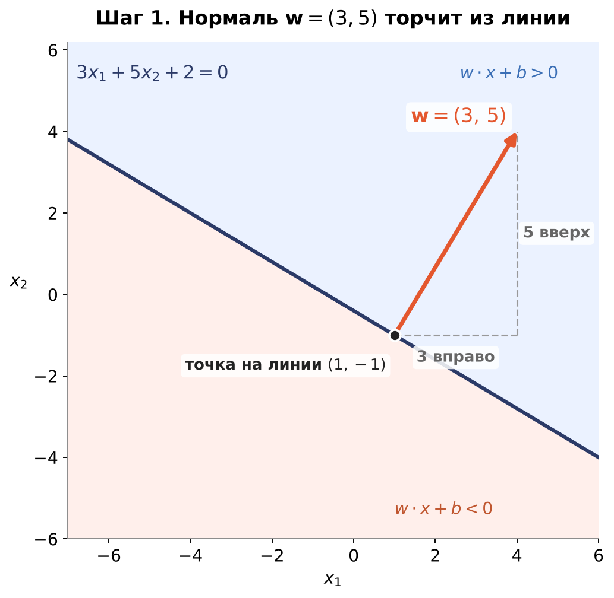
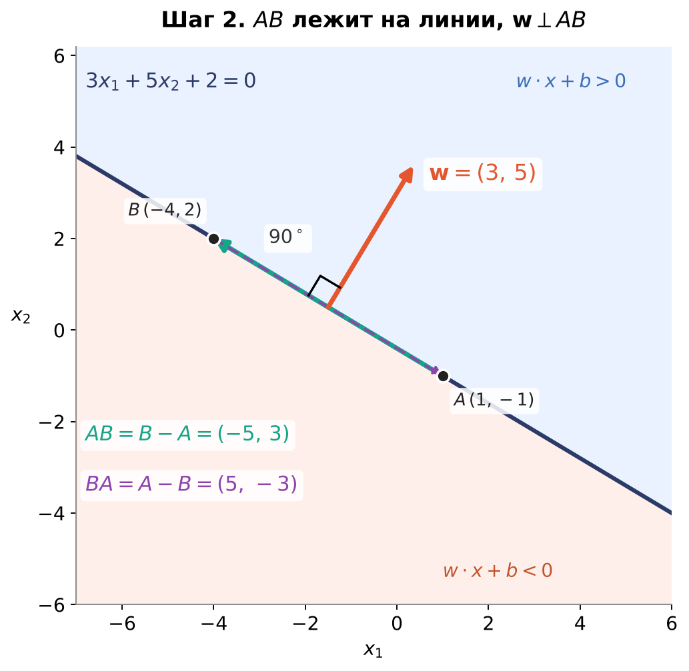
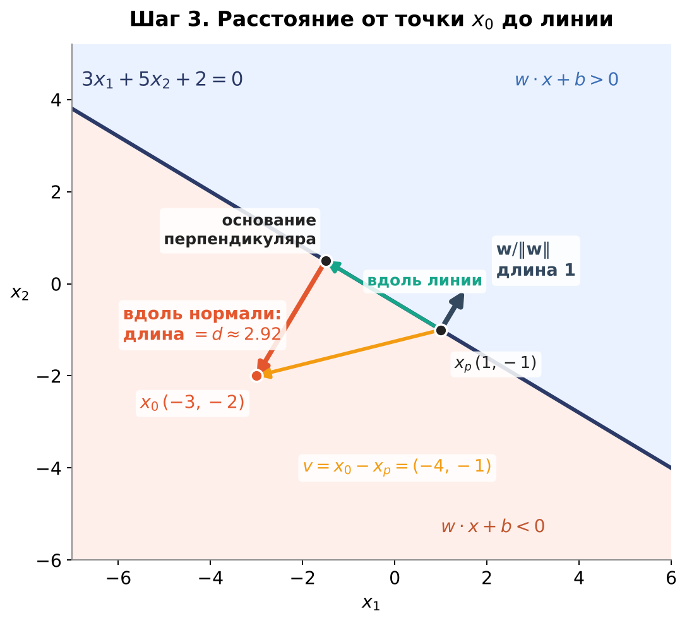

# SVM. Теория. Часть 1: геометрия (нормаль, перпендикулярность, расстояние)

Все примеры считаем на одной и той же линии:

$$3x_1 + 5x_2 + 2 = 0$$

В общем виде гиперплоскость записывается как $\mathbf{w}\cdot\mathbf{x} + b = 0$.
Здесь $\mathbf{w} = (3,\,5)$, $\mathbf{x} = (x_1,\,x_2)$, $b = 2$. В двух измерениях гиперплоскость — это просто линия.

---

## 1. Нормаль к линии

Строим перпендикуляр к линии $3x_1 + 5x_2 + 2 = 0$. Такой перпендикуляр называется **нормалью**.

**Как получить вектор нормали.** Смотрим на исходную формулу $3x_1 + 5x_2 + 2 = 0$
и выдёргиваем оттуда коэффициенты при $x_1$ и $x_2$. Составляем из них вектор:

$$\mathbf{w} = (3,\,5)$$

Это и есть вектор нормали. Отдельно считать ничего не нужно: он «читается» прямо из уравнения.
Свободный член $+2$ в вектор не входит, он нужен только для положения линии.

Как читать график: вектор $\mathbf{w} = (3,\,5)$ нарисован из точки $(1,\,-1)$, которая лежит на линии.
Проверка: $3\cdot 1 + 5\cdot(-1) + 2 = 3 - 5 + 2 = 0$.
От этой точки идём вправо по $x_1$ на 3 единицы и вверх по $x_2$ на 5 единиц.

**Факты о нормали:**

- Она не лежит на линии, она торчит из неё строго перпендикулярно.
- Она содержит всю необходимую информацию о наклоне линии $3x_1 + 5x_2 + 2 = 0$.
  Если поменять $\mathbf{w}$, наклон линии поменяется.

Пока это только утверждение. В следующем шаге проверим его.

---

## 2. Проверяем перпендикулярность: связь линии и вектора нормали

**Вопрос.** Как убедиться, что вектор $(3,\,5)$ действительно описывает линию
$3x_1 + 5x_2 + 2 = 0$, а не какую-то другую?

**Идея.** Если $\mathbf{w}$ перпендикулярен линии, то он должен быть перпендикулярен любому
вектору, который лежит на этой линии. Проверим это на одном таком векторе.

### 2.1. Берём две точки на линии

Важно не запутаться: обе точки берём именно **из самой линии** $3x_1 + 5x_2 + 2 = 0$.
Они нужны, чтобы построить вектор, который лежит на линии.

$$A = (1,\,-1) \qquad 3\cdot 1 + 5\cdot(-1) + 2 = 0 \;\checkmark$$

$$B = (-4,\,2) \qquad 3\cdot(-4) + 5\cdot 2 + 2 = 0 \;\checkmark$$

### 2.2. Строим вектор из двух точек

Правило: **конец минус начало**. Вектор, идущий из точки $A$ в точку $B$,
равен координатам $B$ минус координаты $A$, покоординатно:

$$\vec{AB} = B - A = \bigl(-4 - 1,\; 2 - (-1)\bigr) = (-5,\,3)$$

Это стрелка, которая лежит прямо на нашей линии.

Обратный вариант тоже верен. Вектор из $B$ в $A$:

$$\vec{BA} = A - B = \bigl(1 - (-4),\; -1 - 2\bigr) = (5,\,-3)$$

$\vec{BA}$ — тот же вектор с обратным знаком ($\vec{BA} = -\vec{AB}$). Они оба лежат на одной линии,
просто смотрят в разные стороны, поэтому подходит любой из них.

### 2.3. Скалярное произведение (кратко)

Скалярное произведение двух векторов показывает, насколько они сонаправлены:

$$\mathbf{a}\cdot\mathbf{b} = a_1 b_1 + a_2 b_2 = |\mathbf{a}|\,|\mathbf{b}|\cos\theta$$

- больше нуля — векторы смотрят примерно в одну сторону;
- меньше нуля — примерно в противоположные;
- ноль — угол между ними $90^\circ$, то есть они перпендикулярны.

### 2.4. Проверяем угол между $\mathbf{w}$ и $\vec{AB}$

$$\mathbf{w}\cdot\vec{AB} = 3\cdot(-5) + 5\cdot 3 = -15 + 15 = 0$$

Ноль означает, что угол между ними равен $90^\circ$, то есть они **перпендикулярны**.

**Вывод.** $\mathbf{w} = (3,\,5)$ действительно перпендикулярен линии $3x_1 + 5x_2 + 2 = 0$.
Для обратного вектора $\vec{BA}$ результат тот же: $3\cdot 5 + 5\cdot(-3) = 0$.

---

## 3. Расстояние от точки до гиперплоскости

Теперь самое важное для SVM: как посчитать расстояние от точки до линии.

### 3.1. Какие точки берём

Не путаем две точки:

- $x_p = (1,\,-1)$ — точка **на линии** (мы её уже использовали, это $A$);
- $x_0 = (-3,\,-2)$ — точка **вне линии**, расстояние до которой хотим найти.

Проверим, что $x_0$ не лежит на линии: $3\cdot(-3) + 5\cdot(-2) + 2 = -9 - 10 + 2 = -17$.
Не ноль, значит точка вне линии.

От точки на линии строим вектор до точки $x_0$. Правило то же: «конец минус начало».

$$\mathbf{v} = x_0 - x_p = \bigl(-3 - 1,\; -2 - (-1)\bigr) = (-4,\,-1)$$

Вектор $\mathbf{v}$ выходит из точки $x_p$.

### 3.2. Раскладываем $\mathbf{v}$ на две составляющие

Вектор $\mathbf{v}$ можно разложить на:

- составляющую **вдоль линии** (зелёная стрелка на графике);
- составляющую **вдоль нормали** $\mathbf{w}$ (красная стрелка).

Длина красной составляющей — это и есть искомое расстояние $d$: она идёт от основания
перпендикуляра на линии прямо до $x_0$.

### 3.3. Что такое $\mathbf{w}/\|\mathbf{w}\|$

Нормаль $\mathbf{w} = (3,\,5)$ показывает направление, но у неё своя длина. Для измерения расстояния
нужна стрелка длины ровно 1 в том же направлении. Получаем её делением на длину:

$$\|\mathbf{w}\| = \sqrt{3^2 + 5^2} = \sqrt{34} \approx 5.83$$

$$\frac{\mathbf{w}}{\|\mathbf{w}\|} = \frac{(3,\,5)}{5.83} \approx (0.51,\;0.86)$$

Это **единичный вектор нормали**. На графике он показан тёмной короткой стрелкой из $x_p$:
то же направление, что у $\mathbf{w}$, но длина 1. Его удобно использовать как линейку.

### 3.4. Расстояние — это проекция $\mathbf{v}$ на $\mathbf{w}/\|\mathbf{w}\|$

Проекция вектора на единичный вектор — это просто скалярное произведение с ним:

$$\text{проекция} = \mathbf{v}\cdot\frac{\mathbf{w}}{\|\mathbf{w}\|} = \frac{\mathbf{v}\cdot\mathbf{w}}{\|\mathbf{w}\|}$$

Считаем по шагам:

$$\mathbf{v}\cdot\mathbf{w} = (-4)\cdot 3 + (-1)\cdot 5 = -12 - 5 = -17$$

$$\text{проекция} = \frac{-17}{\sqrt{34}} \approx \frac{-17}{5.83} \approx -2.92$$

Знак минус говорит о том, что $x_0$ лежит с **обратной** от $\mathbf{w}$ стороны: нормаль $\mathbf{w}$ смотрит
вверх-вправо, а $x_0$ находится вниз-влево от линии. Само расстояние всегда положительное,
поэтому берём модуль:

$$d = \frac{|-17|}{\sqrt{34}} \approx 2.92$$

Проверка по графику: красная стрелка идёт из $(-1.5,\,0.5)$ в $(-3,\,-2)$,
её длина $\sqrt{1.5^2 + 2.5^2} = \sqrt{8.5} \approx 2.92$. ✓

### 3.5. Избавляемся от выбора точки $x_p$

Согласитесь, неудобно каждый раз искать конкретную точку на линии и от неё считать проекцию.
Давайте уберём этот шаг, чтобы считать расстояние сразу по самой точке $x_0$.

До сих пор мы просто делали обычную вещь: взяли один вектор, спроектировали на другой и
получили расстояние. Теперь упростим формулу.

Расписываем $\mathbf{v} = x_0 - x_p$:

$$d = \frac{|\mathbf{w}\cdot\mathbf{v}|}{\|\mathbf{w}\|}
= \frac{|\mathbf{w}\cdot(x_0 - x_p)|}{\|\mathbf{w}\|}
= \frac{|\mathbf{w}\cdot x_0 - \mathbf{w}\cdot x_p|}{\|\mathbf{w}\|}$$

Точка $x_p$ лежит **на линии**, значит удовлетворяет её уравнению:

$$\mathbf{w}\cdot x_p + b = 0 \quad\Longrightarrow\quad \mathbf{w}\cdot x_p = -b$$

Проверка на числах: $\mathbf{w}\cdot x_p = 3\cdot 1 + 5\cdot(-1) = -2$, и действительно $-b = -2$.

Подставляем $-b$ вместо $\mathbf{w}\cdot x_p$:

$$d = \frac{|\mathbf{w}\cdot x_0 - (-b)|}{\|\mathbf{w}\|}$$

Минус на минус даёт плюс. Итоговая формула:

$$\boxed{\,d = \frac{|\mathbf{w}\cdot x_0 + b|}{\|\mathbf{w}\|}\,}$$

Проверяем на нашем примере:

$$\mathbf{w}\cdot x_0 + b = 3\cdot(-3) + 5\cdot(-2) + 2 = -17
\qquad\Rightarrow\qquad
d = \frac{|-17|}{\sqrt{34}} \approx 2.92$$

Получилось то же самое число, что и через $x_p$.

### 3.6. Что нам это дало

Мы избавились от необходимости знать точку на плоскости. Теперь для расстояния нужны
только:

- параметры самой гиперплоскости $\mathbf{w}$ и $b$;
- координаты точки $x_0$ вне плоскости.

Заодно получили бонус: знак выражения $\mathbf{w}\cdot x_0 + b$ говорит, по какую сторону
от плоскости лежит точка (на графиках это синяя и розовая области). Здесь он отрицательный
($-17$), то есть точка с обратной от $\mathbf{w}$ стороны. Именно на этом держится
классификация в SVM.
